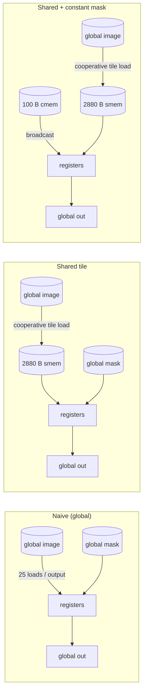
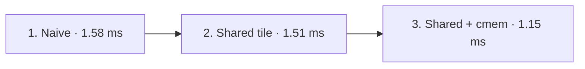

A 5×5 image stencil looks like a textbook GPU exercise until you ask where the bytes actually come from. On an RTX 3060 Ti (Ampere, `sm_86`, CUDA 13.2), I wanted three CUDA variants on the same problem: global-memory naive, shared-memory tile, shared tile plus **constant memory** for the mask. The interesting part is not that shared memory helps (it usually does), but how much a broadcast-friendly mask buys you once the compare is honest about grid size and normalization.

The upstream repo shipped mismatched shapes (1024 vs 12800). I patched every variant to **4096×4096**, **5×5 filter divided by 35**, block **32×16**, and checked **TEST PASSED** before trusting timings.

## Data path: naive vs shared vs constant

Each thread owns one output pixel. A 5×5 stencil reads 25 neighbors per output. The three kernels differ in where those neighbors live during the multiply-add.



Naive: every tap hits global memory for image and mask. Shared: one halo tile per block, one `__syncthreads`, mask still from global. Constant: tile reuse stays; the 25 mask weights sit in constant memory and broadcast across the warp.

---

## Build, ptxas, kernel times

Hardware: **RTX 3060 Ti**, **sm_86**, **CUDA 13.2**. Three timed runs per kernel; I kept the stable minimum each time.

```bash
make clean && make
./convolution   # or project-specific binary after fair-size patch
nvcc --ptxas-options=-v -c convolution_*.cu   # per translation unit
```

**ptxas resource summary**

| Variant | Registers | Shared mem | Constant |
|---------|-----------|------------|----------|
| Naive | 16 | 0 | 0 |
| Shared tile | 40 | 2880 B | 0 |
| Shared + constant mask | 36 | 2880 B | 100 B (`cmem[3]`) |

Barriers: naive **1**; both shared paths **1** (tile fill + compute).

### Performance for 4096×4096 convolution

Fixed grid, same filter and block shape, min of three kernel runs. Output rate is `4096² / t` (pixels per second from kernel time only). Relative time is vs the naive kernel.

| Step | Kernel | Time | vs naive | Output rate |
|------|--------|------|----------|-------------|
| 1. Naive (global) | global image + mask | ~1.58 ms | 1.00× | ~10.6 GPix/s |
| 2. Shared tile | + 2880 B smem halo | ~1.51 ms | 1.05× | ~11.1 GPix/s |
| 3. Shared + constant mask | + 100 B `__constant__` mask | ~1.15 ms | 1.37× | ~14.6 GPix/s |



The middle step barely moves (~4%): Ampere L2 already absorbs a lot of the stencil traffic. The constant-memory mask is the bar that pays (~27% off shared).

Example console shape (numbers from one stable run):

```text
Grid: 4096 x 4096, block 32 x 16, filter 5 x 5 / 35
TEST PASSED
naive kernel:     ~1.58 ms
shared kernel:    ~1.51 ms
constant kernel:  ~1.15 ms
H2D copy:         ~24-26 ms
D2H copy:         ~24-26 ms
wall clock:       ~50 ms class (transfer-heavy)
```

The repo also has an **OpenACC** path on **10000×10000**; that is a different toolchain and size, not a fourth CUDA kernel in this A/B.

---

## Why constant + shared wins here

**Tile reuse** is the first win. A 32×16 output block with a 5×5 stencil needs a halo; staging that tile in **2880 B** of shared memory cuts repeated global traffic for interior pixels. That alone only nudges naive (~1.58 ms) toward shared (~1.51 ms): Ampere's L2 is doing real work anyway, and register pressure rises (16 → 40 regs).

**Mask in constant memory** is the second win. The 5×5 weights are identical for every thread. Loading them from global each tap adds 25 extra global transactions per output that do not scale with image reuse. **`__constant__`** gives warp-wide broadcast: one read can serve many lanes. That shows up in both ptxas (36 regs vs 40) and the ~**27%** kernel drop (~1.51 → ~1.15 ms) on top of tiling.

I read this as a small memory-hierarchy story: optimize what repeats (mask) and what overlaps (image halo), then verify with **fair dimensions** so you are not comparing a tiny grid against a monster.

---

## Caveat: PCIe still owns the clock

Kernel optimization is real but **not** what dominated wall time in this harness. Keep transfers off the ladder above; they get their own line:

| Path | Time (approx.) |
|------|----------------|
| Best kernel (shared + cmem) | ~1.15 ms |
| H2D + D2H | ~48–52 ms |
| Wall clock (transfer-heavy) | ~50 ms class |

Report kernel A/B first (controlled problem size, `TEST PASSED`), then say the end-to-end app is transfer-bound until inputs live on the GPU across iterations.

What I would check next:

- **Nsight Compute (`ncu`)**: DRAM/L2 bytes per output, achieved occupancy vs the 2880 B smem block.
- **Pinned host memory + async copy**: overlap H2D with something useful, or keep the buffer resident and time kernel-only in a loop.

---

## Takeaways

1. **Measure, then name the bottleneck.** Kernel ms looked competitive only after fixing 4096×4096 everywhere; mismatched sizes would have lied about speedup.
2. **Memory hierarchy beats clever arithmetic** on stencils: shared tiles for spatial reuse, constant memory for coefficients that broadcast across a warp.
3. **Fair A/B is part of perf engineering.** Same grid, same normalization (/35), same block shape, pass/fail gate, then min-of-three kernel times; wall clock gets its own line when PCIe is in play.
