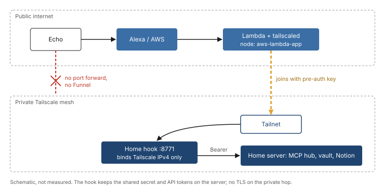
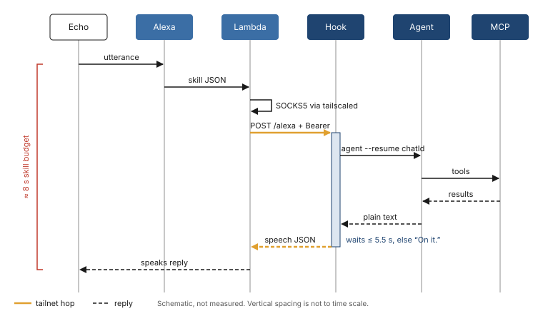

Alexa runs in Amazon's cloud. My tools run on a home server: a personal MCP hub (local log, knowledge vault, Notion, and more) that Cursor and Opencode already use. I wanted the kitchen Echo to use the same hub, without port forwarding, Funnel, or one skill intent per MCP tool.

Echo cannot run Tailscale, but the skill's Lambda can. So Lambda joins the private mesh and reaches home the same way my laptop does.

---

## Architecture


AWS is only a voice relay (HTTPS, speech understanding, skill timeout). The agent, tool calls, and secrets stay at home. One free-text intent replaces one intent per MCP tool: the agent picks the tool.



---

## Why Tailscale in Lambda

Alexa cannot reach LAN devices. Normally you either make the home side public or open a hole (port forward, Funnel, ngrok-style tunnel). I wanted Lambda to be just another peer on the mesh.

The container image on **ECR** runs `tailscaled` in userspace mode with a **SOCKS5** proxy on `127.0.0.1`. PySocks sends outbound sockets through it. On cold start, Lambda joins the tailnet as `aws-lambda-app` with a pre-auth key, then POSTs to `http://<tailnet-ip>:8771/alexa`.

At home, the hook binds the **Tailscale IPv4 only**, not `0.0.0.0`. It checks a shared Bearer secret. There is no TLS on that hop, since it is a private mesh. Funnel stays off.

### Setup sketch

1. **Tailnet**: create a reusable/ephemeral pre-auth key for the Lambda node; tag it if you use ACLs.
2. **Home hook**: listen on `$(tailscale ip -4):8771`, require `Authorization: Bearer …`, keep the secret and Notion/API tokens on the server.
3. **Lambda image**: install `tailscaled`, start userspace networking + SOCKS5, join with the pre-auth key, send HTTP through the proxy.
4. **Alexa skill**: one free-text intent; Lambda takes the utterance and Amazon `userId` and POSTs them to the hook.

Smoke test from any tailnet node:

```bash
curl -sS -H "Authorization: Bearer $ALEXA_HOOK_SECRET" \
  -H 'Content-Type: application/json' \
  -d '{"utterance":"list todos","userId":"test"}' \
  "http://$(tailscale ip -4):8771/alexa"
```

---

## Request path and the 8-second wall



Lambda takes the utterance, POSTs it to the hook, and returns speech. The hook maps each Amazon `userId` to a `chatId`, runs `agent create-chat` the first time, then:

```bash
agent --resume <chatId> -p --trust --approve-mcps --force \
  --workspace ~/Documents/alexa-tailscale-container \
  --model composer-2.5-fast --output-format text "<voice prompt>"
```

Voice gets a tighter allowlist (`Mcp(personal:*)`, web search/fetch, a few shell commands). Replies lose their markdown and are capped at **700** characters.

Alexa wants a response in about **8 seconds**. A full agent run often takes longer. So the hook runs the agent in a background thread and waits up to **5.5 s**. If the job is not done, it answers **"On it."** and reprompts with **"Say result."** You ask again later. Ugly, but it fits Amazon's limit.

| Phase | Limit | Behavior |
| :--- | :--- | :--- |
| Hook wait (fast path) | 5.5 s | Return speech if done |
| Lambda → hook HTTP | 7 s × 3 retries | Fail / retry |
| Agent subprocess | ~22 s | "That took too long" if exceeded |
| Speech cap | 700 chars | Truncate for TTS |

The Alexa session and the agent chat live separately. **Stop** ends only the Alexa session; the `chatId` stays until you reset state.

---

## Takeaways

1. **Put Tailscale in Lambda** so Alexa reaches tailnet peers without public exposure.
2. **Bind the hook to the Tailscale IP**, not `0.0.0.0`; rotate the hook secret and auth keys if leaked.
3. **Use AWS only as a voice relay**; agent and MCP stay at home.
4. **Use one free-text intent**; let the agent pick tools.
5. **Plan for the ~8 s skill timeout** from day one (background job + "result" poll).

Deploy details (ECR push, Lambda image, skill slots) are in the `alexa-tailscale-container` repo and in `personal://alexa`.
