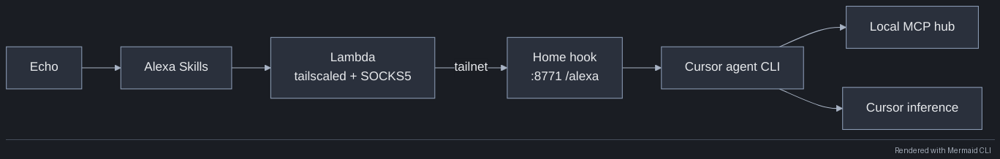
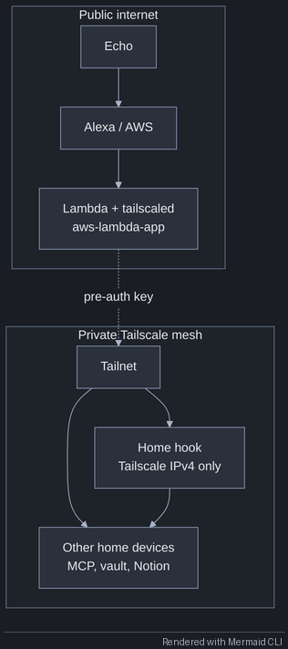
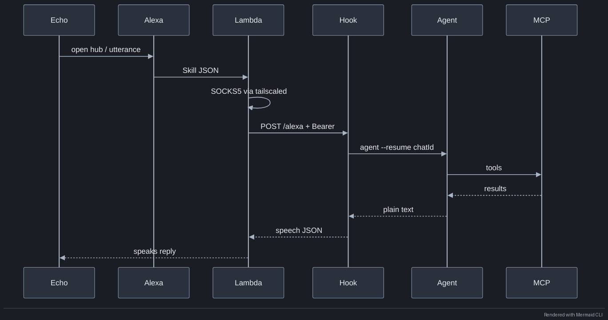

Alexa lives on Amazon's cloud. My tools live on a home server: a personal MCP hub (local log, knowledge vault, Notion, and related backends) that Cursor and Opencode already talk to. I wanted the kitchen Echo to use that same surface without port-forwarding, Funnel, or re-implementing each MCP tool as a skill intent.

Echo cannot run Tailscale. The fix is to put Tailscale inside the skill's Lambda, so AWS joins the private mesh and reaches home the same way my laptop already does.

---

## Architecture



AWS stays a voice relay (HTTPS, NLU, skill timeout). Inference and tool calls stay on the home agent. Secrets stay on the tailnet. One free-text intent beats N intents for N MCP tools: the agent routes.



---

## Why Tailscale in Lambda

By default, Alexa cannot reach LAN devices. Anything home-side has to be public, or you punch a hole (port forward, Funnel, ngrok-style tunnels). I wanted zero-trust: Lambda reaches me the way my laptop does, as a peer on the mesh.

The container image on **ECR** bundles `tailscaled` in userspace mode with a **SOCKS5** proxy on `127.0.0.1`. PySocks sends outbound sockets through it. On cold start, Lambda joins the tailnet as `aws-lambda-app` with a pre-auth key. From there it POSTs to `http://<tailnet-ip>:8771/alexa` like any other node.

On the home server, the hook binds the **Tailscale IPv4 only**, not `0.0.0.0`. Shared Bearer secret, no TLS on that hop (private mesh). Funnel stays off.

### Setup sketch

1. **Tailnet**: create a reusable/ephemeral pre-auth key for the Lambda node; tag it if you use ACLs.
2. **Home hook**: listen on `$(tailscale ip -4):8771`, require `Authorization: Bearer …`, keep the secret and any Notion/API tokens on the server.
3. **Lambda image**: install `tailscaled`, start userspace networking + SOCKS5, join with the pre-auth key, route HTTP via the proxy.
4. **Alexa skill**: one free-text intent; Lambda extracts utterance + Amazon `userId`, POSTs to the hook.

Smoke test from another tailnet node (or the home box):

```bash
curl -sS -H "Authorization: Bearer $ALEXA_HOOK_SECRET" \
  -H 'Content-Type: application/json' \
  -d '{"utterance":"list todos","userId":"test"}' \
  "http://$(tailscale ip -4):8771/alexa"
```

---

## Request path and the 8-second wall



Lambda's handler extracts the utterance, POSTs to the hook, and returns speech. The hook maps each Amazon `userId` to a `chatId`, runs `agent create-chat` on first contact, then:

```bash
agent --resume <chatId> -p --trust --approve-mcps --force \
  --workspace ~/Documents/alexa-tailscale-container \
  --model composer-2.5-fast --output-format text "<voice prompt>"
```

Voice gets a tighter allowlist (`Mcp(personal:*)`, web search/fetch, a small shell set). Replies are stripped of markdown and capped at **700** characters.

Alexa skills want a response in roughly **8 seconds**. Sync waiting for a full agent run does not survive that. The hook starts the agent in a background thread, waits up to **5.5 s**, and if the job is still running returns **"On it."** with a reprompt to **"Say result."** You poll later. Ugly, but it fits Amazon's budget.

| Phase | Limit | Behavior |
| :--- | :--- | :--- |
| Hook wait (fast path) | 5.5 s | Return speech if done |
| Lambda → hook HTTP | 7 s × 3 retries | Fail / retry |
| Agent subprocess | ~22 s | "That took too long" if exceeded |
| Speech cap | 700 chars | Truncate for TTS |

Alexa session and agent chat are separate lifetimes. **Stop** ends Alexa only; the `chatId` stays until you reset state.

---

## Takeaways

1. **Put Tailscale in Lambda** so Alexa can reach tailnet peers without public exposure.
2. **Bind the hook to the Tailscale IP**, not `0.0.0.0`; rotate hook secret and auth keys if leaked.
3. **Keep AWS as voice relay**; agent + MCP stay at home.
4. **One free-text intent**; let the agent pick tools.
5. **Design for the ~8 s skill timeout** from day one (background job + "result" poll).

Deploy details (ECR push, Lambda image, skill slots) live in the `alexa-tailscale-container` repo and in `personal://alexa`.
