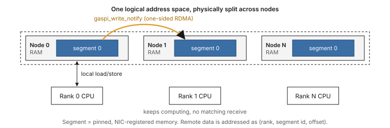
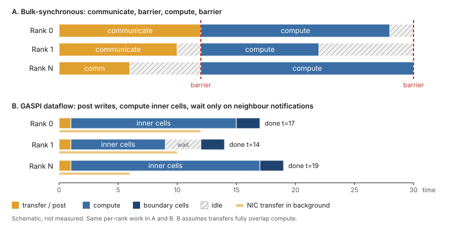

Most of my HPC work so far lives in the **MPI** world: OpenMPI, UCX transport selection, checking that a containerized job really uses InfiniBand and not TCP.

I spent two days in an online **HLRS** tutorial on **GASPI** (Global Address Space Programming Interface). It raised a question I keep hitting: what if the bottleneck is not the network, but the communication *model* we wrap around it?

GASPI is a standardized PGAS API. It is built on one-sided RDMA, asynchronous queues, and fine-grained notifications instead of two-sided sends and global barriers. These are my notes.

---

## Why Another Communication API?

At scale, communication costs latency, bandwidth, energy, and money. Classic message passing often serializes compute and communication when the hardware could do both at once.

GASPI does not try to replace MPI. It gives low-level building blocks so you can structure parallelism around **data dependencies** instead of phases. Five guidelines came up again and again:

1. **Overlap communication and computation.** Post transfers asynchronously and keep the CPU busy while the NIC moves data.
2. **Zero copy.** Write application buffers straight to remote memory. No bounce buffers.
3. **No automatic synchronization.** Global barriers amplify load imbalance and OS jitter. Synchronize only along real dependencies.
4. **Exploit the hierarchy.** Core, NUMA node, socket, node, network: keep local traffic local.
5. **One-sided communication.** The initiator gives source, target, and size. The remote CPU does not post a matching receive.

The last point hit home after my UCX debugging on Snellius. There I had to prove MPI actually used InfiniBand. GASPI assumes the direct hardware path from the start.

---

## PGAS and Segments

GASPI is a **Partitioned Global Address Space (PGAS)** model. Memory is physically spread across nodes, but every rank can address remote partitions in one logical space.



The unit of that space is the **segment**: a contiguous block of memory registered with the NIC.

* **`gaspi_segment_alloc`** allocates and pins memory so it stays resident for **RDMA**.
* **`gaspi_segment_register`** makes the segment available for local access and remote one-sided operations.

Reads, writes, and notifications all operate on segments.

---

## The Three API Pillars

### One-Sided Transfers

* **`gaspi_write`**: put local data into remote memory.
* **`gaspi_read`**: get remote data into local memory.

Both return immediately. Completion is tracked through queues.

### Queues

Every read and write goes through a local **communication queue**. Queues are finite; a full queue returns `GASPI_QUEUE_FULL`.

**`gaspi_wait`** flushes a queue. After it returns, read data is visible and write source buffers can be reused.

### Notifications

One-sided transfers do not wake the remote CPU. Notifications tell the other side that data has landed:

* **`gaspi_notify`**: set a notification ID on a remote segment.
* **`gaspi_notify_waitsome`**: block until selected IDs become non-zero.
* **`gaspi_notify_reset`**: reset an ID and return its old value.

**`gaspi_write_notify`** and **`gaspi_write_list_notify`** fuse a transfer and its signal into one call.

| Mechanism | Role |
| :--- | :--- |
| `gaspi_write` / `gaspi_read` | Async data movement between segments |
| Queue + `gaspi_wait` | Local completion and buffer reuse |
| `gaspi_notify*` | Remote readiness without a matching receive |

---

## From Bulk Synchronous to Dataflow

The biggest idea was not an API call. It was the change in execution model.

A classic MPI stencil or ring exchange is bulk synchronous: communicate, barrier, compute, barrier. CPUs idle while the network works, then the network idles while CPUs compute. Every barrier waits for the slowest rank.

GASPI splits each subdomain into **inner** cells (no remote data needed) and **boundary** cells (need neighbour data):

1. Post boundary transfers with `gaspi_write_notify`.
2. Compute inner cells while the NIC moves boundary data.
3. Wait for the specific neighbour notifications with `gaspi_notify_waitsome`, not a global barrier.
4. Compute boundary cells.



Each rank advances when its own dependencies are met, not when the slowest rank catches up. The tutorial claims near-optimal overlap when the split is done well. Figure 2 shows that best case. I have not benchmarked it myself.

---

## Mixed Mode with MPI

Full rewrites are unrealistic for most production codes. GASPI supports **incremental porting** next to MPI:

* GASPI ranks match the existing MPI ranks.
* **`gaspi_segment_use`** registers buffers MPI already allocated, so there are no duplicate allocations or copies.

```
MPI_Init(&argc, &argv);
gaspi_proc_init(GASPI_BLOCK);

// heterogeneous MPI + GASPI work here

gaspi_proc_term(GASPI_BLOCK);
MPI_Finalize();
```

Keep MPI for coarse structure and I/O. Use GASPI in the hot loop where overlap matters.

---

## Open Questions

* Does the notification-driven stencil beat a well-tuned MPI+UCX version on the same partition?
* In mixed mode, does segment registration break when containers isolate user-space drivers, as I saw with fully contained images on Snellius?

---

## Takeaways

1. **Treat barriers as a design smell.** Ask whether a local notification can replace a global `MPI_Barrier`.
2. **Think in segments, not messages.** Pinned, registered memory is the unit of fast transfer.
3. **Overlap before you optimize bandwidth.** Splitting inner and boundary cells buys parallelism that a phased loop leaves on the table.
4. **Port incrementally.** `gaspi_segment_use` lets you test one kernel without a rewrite.
5. **Verify on your machine.** As with UCX, confirm the runtime takes the hardware path you expect.

---

### References

* Fraunhofer ITWM / HLRS, *GASPI Tutorial* (2-day online course, 2026). [Certificate](/assets/blog/demystifying-gaspi-hlrs-tutorial/personal-certificate.pdf).
* GASPI Consortium, [GASPI Standard and Documentation](https://www.gaspi.de/).
* Full list: [All references](/readinglist/).
