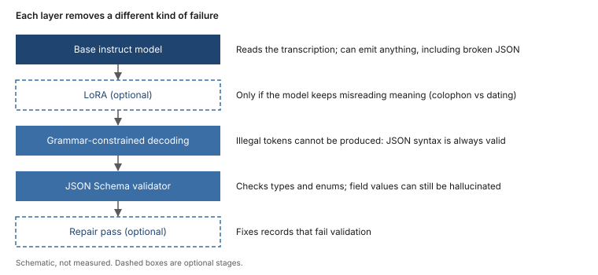
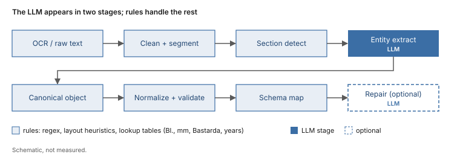
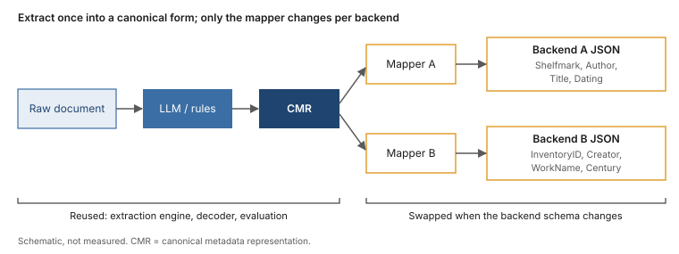
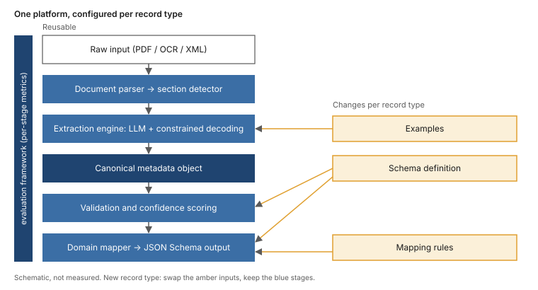

This post starts a series on porting a large body of unstructured university library data into a new metadata editing backend. It is not a one-shot ETL script: legacy catalog records must go through the new system's API, so every payload has to be extracted and validated first. Hosted APIs are off the table, so batch inference, fine-tuning, and evaluation will run on the local university HPC cluster.

The first hard problem is manuscript transcriptions from the **7th century onward**: noisy historical text with Latin nomenclature, abbreviations, and transcription styles that shift across centuries and catalogers. All of it has to become valid JSON against a fixed schema. Here is my initial plan, plus a few early experiments that already changed direction. Later posts cover the pieces that broke that plan in interesting ways, including [LoRA on a catalog-splitting sub-problem](/blog/Teaching-a-700M-Model-to-Cut-Catalogs-LoRA-on-an-8GB-GPU/) when exact substring lists beat prompting.

---

## The Setup

Most extraction advice assumes thousands of labeled documents. I have a **small validation set** (roughly 100 to 1000 examples), a **fixed JSON schema**, manuscripts from the 700s to the early modern period, and on-premise inference.

A catalog entry is not clean prose. Eight centuries of cataloging practice end up in one block: Latin titles and incipits, scholastic and paleographic abbreviations, watermark references, binding notes, uncertain readings, and conventions that depend on who wrote the entry and when:

```text
M.ch.f. 124

Thomas Aquinas: Summae theologicae pars I

Pergament u. Papier 322 Bl. 307 x210 mm Ostfranken oder Leipzig
1463

Bl. 1 u. 11 sind aus Pergament. Wasserzeichen: Turm, Piccard II, 337. ...
Bastarda. Rubriziert. 2r: Darstellung des Thomas in Q (deckende Farben. Blattgold).
...
316r: finitus per Io(annem) Lanckheym. 1463. in die saneti Sebastiani.
...
Benützte Ed.: S.Thomae Aquinatis Opera omnia iussu Leonis XIII. ed., t.4-5, Romae 1888-1889.
```

The target is structured metadata: shelfmark, author, title, material, dimensions, dating, script, decoration, collation, binding, colophon, marginalia, cited editions. Valid JSON with schema-compliant types and enums, ingestible without fixing every field by hand.

That is **constrained semantic parsing**: unstructured text in, valid JSON out, with very little supervision.

---

## The Wrong First Question

The natural first question is *which paper should I read to fine-tune on my validation set?*

With small data, a fixed schema, and noisy text, these lines of work matter more than another NER benchmark:

| Paper / line of work | Why it matters |
| :--- | :--- |
| SFT memorization & generalization (2024/25) | Whether a small supervised set generalizes or just memorizes |
| Outlines / grammar-constrained decoding | Guarantees syntactically valid JSON at generation time |
| DSPy (2024) | Optimizes prompts and pipeline modules against a validation metric |
| Structured outputs / Instructor-style APIs | Typed objects internally, JSON at the boundary |
| Inference-time scaling / test-time compute | More decode-time compute on hard cases instead of retraining |
| DocIE / KIE benchmarks | Evaluation methodology, less direct implementation value |

**Read first:** SFT memorization and generalization. Will tuning on a few hundred JSON examples hold up on unseen documents?

**Implement first:** grammar-constrained decoding. Probably the biggest practical win for schema-shaped output.

---

## Why Fine-Tuning Should Not Be Step One

With little data, formatting and schema errors are cheaper to remove with decoding constraints than with more gradient steps. Fine-tuning feels like progress when the cluster has free GPUs, but the papers increasingly say it should come later.

Without constraints, a model can emit broken JSON. With a grammar-backed decoder, illegal tokens cannot be produced. The model can still hallucinate field *values*, but not break the syntax.



Fine-tuning belongs in the stack when the model keeps misreading *meaning* (colophon confused with dating, nested physical description dropped) after constraints and prompting are in place. Not when it forgot a closing brace.

---

## Early Experiments: Vision Models, Schema Size, and Prefilling

Before building the on-premise stack, I tried a few hosted tools that return structured data from documents in one pass. **Datalab Lift** is one: a vision model that reads multi-page input and returns JSON in one shot. Seeing the whole document helps when a field spans pages (a colophon on the last leaf, a watermark note continued on the next card). But my input is already **raw transcription text**, not scans, and the vision pipeline still produced OCR-style misreadings on strings that were already correct. For this migration a text-native or properly tuned multimodal model looks like the better bet.

Single-pass multi-page extraction also hits a performance cliff. Without preprocessing, batching, or chunking, latency and cost climb fast with page count. Worth keeping, but it needs infrastructure around it, not just a bigger context window.

The target schema has **more than 50 properties**, with nested objects (e.g. `manuscript` → `chapter`). A **10B** instruct model gave promising results, but I suspect it would do better if I chunked the extraction instead of asking for the full tree at once. That fits the CMR idea below: decompose first, map to the final API payload later.

One cheap win came before any fine-tuning: **enriching the JSON Schema itself**. Filling the `description` of each property with catalog-specific context (what "colophon" means in this archive, how uncertain dating is encoded) noticeably improved field quality with no weight updates. The schema is part of the prompt, not just validation glue.

The strongest result so far, across every variant: **prefill the output JSON as far as regex and heuristics allow**, then let the model finish. Shelfmarks, dimensions, leaf counts, four-digit years and similar patterns are high-precision from rules. Starting from a partly filled document beat blank-slate extraction every time. I would build around that whether the backend is a 10B local model, grammar-constrained decoding, or a future fine-tune.

---

## Pipeline Shape

The manuscript case should generalize across the migration: raw text mapped to a predefined schema across record types, input formats, and nesting depths. The useful literature treats extraction as a **pipeline**, not a single prompt.

For manuscripts, the LLM only needs a few stages:



Regexes, layout heuristics, and lookup tables handle a surprising amount of catalog boilerplate (`Bl.`, `mm`, `Bastarda`, four-digit years). The model is for semantic glue, not every token.

**Do not extract straight into the target schema.** Use a canonical metadata representation (CMR) plus a mapper:



```json
{
  "works": [{ "author": "Thomas Aquinas", "title": "Summa theologicae", "part": "pars I" }],
  "physical_description": {
    "materials": ["Pergament", "Papier"],
    "extent": "322 Bl.",
    "dimensions_mm": { "height": 307, "width": 210 },
    "script": "Bastarda"
  },
  "dating": { "year": 1463, "place": "Ostfranken oder Leipzig" }
}
```

One backend might want `Shelfmark`, `Author`, `Title`, `Dating`; another `InventoryID`, `Creator`, `WorkName`, `Century`. Only the mapper changes; the extraction engine, constrained decoder, and evaluation harness stay. Since the new API schema may still shift during the port, that indirection is worth building early.

---

## Papers I'm Starting From

**DSPy** (Khattab et al., 2024): define a signature (`catalog entry → DocumentMetadata`), a module, and a metric; the optimizer searches prompts, demonstrations, and decomposition. New record type, new signature, same loop.

**Snorkel / data programming** (Ratner et al.): weak labels from heuristics (`.*Bl\.` for leaf count, `\d+ x \d+ mm` for format, `\b14\d{2}\b` for dating) alongside a small gold validation set.

**Grammar-constrained decoding** (Outlines, LM Format Enforcer): valid structure guaranteed at generation time.

**Structured generation / Instructor-style APIs**: typed objects internally, JSON at the boundary.

**Agent Lightning** (2025): relevant once there are several validation and repair stages to optimize jointly.

Together they describe a platform:



Per record type you change the schema definition, mapping rules, and examples. The parser, extraction engine, constrained decoding, and evaluation framework are reused.

---

## Benchmarking

Generic NLP benchmarks rarely tell you whether a record can enter production without manual fixes. **Per-stage metrics** make failures diagnosable:

| Stage | Metric |
| :--- | :--- |
| Section detection | accuracy / boundary F1 |
| Field extraction | precision, recall, F1 per field |
| Schema compliance | % records passing JSON Schema |
| End-to-end acceptance | % insertable without manual fix |

The one that matters most is **end-to-end acceptance**: how many outputs the API accepts as-is. For free-text fields, normalized Levenshtein or CER on titles and colophons is more honest than exact match.

---

## Planned Build Order (On-Premise HPC)

No hosted API means a strong open-weight instruct model, batch evaluation and fine-tuning through the cluster scheduler, and reproducible experiments. Early runs on a 10B model and hosted vision tools already point to prefilling and schema-rich prompting before LoRA. The order I plan to try:

1. **Regex prefilling** into a partial JSON skeleton. Measure how much is left for the model.
2. **Baseline** with a careful prompt and enriched schema descriptions. Measure schema validity and field F1.
3. **Grammar-constrained decoding** against the JSON Schema. Expect a big validity jump.
4. **Chunked extraction** for the nested 50+ field schema before scaling model size.
5. **LoRA fine-tuning** only if semantic errors dominate after steps 2 to 4. For one narrow field (glued literature references → one row per citation), that condition already held; see the [catalog splitter ablations](/blog/Teaching-a-700M-Model-to-Cut-Catalogs-LoRA-on-an-8GB-GPU/).
6. **DSPy or structured prompt search** against the validation metric.
7. **CMR + mapper** before hard-coding domain field names into prompts.
8. **Weak labels** via Snorkel-style rules for high-precision patterns.

Grammar decoding plus modest LoRA looks like the best reliability per GPU hour. Full fine-tuning on hundreds of examples risks memorization and would fight schema changes every time the API payload moves.

---

## Open Questions

* Does a CMR prompted on one catalog convention generalize to others (German nineteenth-century descriptions vs English auction catalogs)?
* Do regex weak labels help more than they hurt on ambiguous readings like `Ostfranken oder Leipzig`?
* How much inference-time compute (reranking, repair passes) can replace extra supervised examples on a cluster budget?
* How to chunk a 50+ field nested schema on a 10B model without losing cross-field dependencies (colophon vs dating, chapter vs manuscript)?
* Is multi-page single-pass extraction worth the batching complexity once preprocessing and scheduling are in place?

These are workflow questions as much as model questions.

---

## Practical Takeaways (For Now)

The bets I am taking into the build, based on the reading and early experiments:
1. **Treat small validation sets as their own regime.** Read SFT generalization work before spending GPU weeks on fine-tuning.
2. **Enforce JSON at decode time.** Grammar-constrained generation removes a failure mode prompting cannot.
3. **Separate canonical extraction from schema mapping.** That is how the pipeline survives backend schema changes.
4. **Use the LLM only where rules stop.** Boilerplate goes to heuristics; colophons and provenance notes go to the model.
5. **Prefill JSON from regex before any model call.** Best ROI so far, across all variants.
6. **Treat the schema as prompt material.** Rich `description` fields improved extraction without fine-tuning.
7. **Match model modality to input.** Raw text should not go through a vision pipeline that adds OCR errors back.
8. **Chunk large nested schemas.** 50+ fields on a 10B model likely needs decomposition.
9. **Optimize for end-to-end acceptance**, not token F1 on a generic leaderboard.
10. **Stack techniques.** LoRA + constrained decoding + validation + optional repair beats any single paper.

---

### References

* Khattab et al., *DSPy: Compiling Declarative Language Model Calls into Self-Improving Pipelines* (2024). [arXiv:2310.03714](https://arxiv.org/abs/2310.03714)
* Ratner et al., *Snorkel: Rapid Training Data Creation with Weak Supervision* (VLDB 2017). [PDF](https://www.vldb.org/pvldb/vol11/p269-ratner.pdf)
* Willard & Louf, *Efficient Guided Generation for Large Language Models* (Outlines, 2023). [arXiv:2307.09702](https://arxiv.org/abs/2307.09702) · [Code](https://github.com/dottxt-ai/outlines)
* Su et al., *One Embedder, Any Task: Instruction-Finetuned Text Embeddings* (Instructor, 2022). [arXiv:2212.09741](https://arxiv.org/abs/2212.09741)
* Chu et al., *SFT Memorizes, RL Generalizes* (2025). [arXiv:2501.17161](https://arxiv.org/abs/2501.17161)
* Lin et al., *Debunk the Myth of SFT Generalization* (2025). [arXiv:2510.00237](https://arxiv.org/abs/2510.00237)
* Luo et al., *Agent Lightning: Train ANY AI Agents with Reinforcement Learning* (2025). [arXiv:2508.03680](https://arxiv.org/abs/2508.03680)
* Gat, [LM Format Enforcer](https://github.com/noamgat/lm-format-enforcer) (grammar-constrained decoding).
* [Marvin](https://github.com/prefecthq/marvin), [Guidance](https://github.com/guidance-ai/guidance), [OpenAI Structured Outputs](https://platform.openai.com/docs/guides/structured-outputs) (typed / structured generation tooling).
* [DocIE benchmark](https://xllms.github.io/DocIE/) (XLLM ACL 2025); [DocRED dataset](https://arxiv.org/abs/1906.06127) (document-level relation extraction).
* Full list: [All references](/readinglist/).

---
