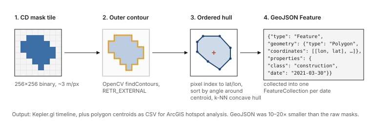

For my bachelor project at the **University of Twente** (Creative Technology, 2021), I worked with **RISE** in Cyprus. Their **Siamese neural networks** compare pairs of Planet satellite images and output **change detection (CD) maps**: 256×256 binary masks covering the area between **Nicosia** and **Larnaca**.

I did not build the model. My job was the middle layer: turn the masks into something policymakers could explore on the web, then relate change patterns to demographic data (Copernicus CORINE, Michael Bauer Research) in **ArcGIS**.

The thesis question: **which correlations show up most often between land use change and demographic factors?**

---

## The Data Shape Problem

Each CD tile is 256×256 pixels at roughly **3 m** per pixel. A two-week comparison over part of a city means **tens of millions** of classified pixels. Kepler.gl and ArcGIS Online cannot play back raw masks as a time series.

After clustering and polygon simplification, the **GeoJSON** output was **10 to 20× smaller** than the raw CD masks, with the same spatial story. That was the difference between "upload times out" and "scrub a timeline."

---

## The Pipeline

The tool is a Processing app with keyboard-switched modes (`scatter`, `line`, `squarify`, `rawData`, `imgCombiner`, contour export). The early modes were for exploration. The path that mattered for the thesis is below.



### Pixel index to coordinate

Each mask file has a companion `Lat_mask_entire` grid. A flat index maps contour pixels to geographic positions:

```text
currentIndex = floor(y) * res + floor(x)
```

Patches are named like `Merge_30032021_0_768.txt` inside an 11776×13312 parent image. The filename *is* the spatial index: step 256 in x to the end of the row, then reset x and step y. `fileNameGenerator()` walks that scheme.

### Contours and hulls

**OpenCV** (`RETR_EXTERNAL`, `CHAIN_APPROX_NONE`) extracts the outer boundary of each blob. Contour points arrive in scan order, which breaks polygon fill in Kepler. So the sketch sorts vertices by angle around the centroid (`geoJSONrearrangeVertexes`), then runs a k-nearest **concave hull** (`testHull`). A concave hull stays tight; a convex hull would bloat the shape.

Each cluster becomes a GeoJSON `Feature` with a timestamp, cluster id, and one change class: reforestation, deforestation, construction, newInfrastructure, cropChange, or mine. Some labels were simulated because the final classified dataset arrived late.

### Side outputs

The same code also wrote **CSV** files for ArcGIS hotspot analysis and **side-by-side JPEG strips** for manual labeling (`printImagesForLabeling`). The final GeoJSON writer is `multiPolyGeoJson()`.

---

## What the Maps Showed

* **Rural vs urban:** farmland around Nicosia and Larnaca produced large contiguous change areas. Inside cities, detections were smaller but more frequent (construction, infill).
* **Time playback:** February to March 2021 showed change spreading east to west between the two cities. This was easier to read as a Kepler timeline than as screenshots.
* **Hotspots:** converting polygons to centroids enabled **Getis-Ord Gi*** maps in ArcGIS. February had few significant clusters; March had many more. This matched what Kepler showed, despite false positives in the CD maps.

**CORINE 2019** land cover added context, but it lags two years, so it cannot show recent urban growth on its own.

For demographics (population, income, purchasing power), I used ArcGIS interpolation. Sparse demographic grids next to 3 m CD data mislead easily, so I dropped large low-confidence cells (for example, a ~69 km² cell estimated from fewer than 10 points).

---

## Looking Back

Later work on MPI and network profiling showed the same pattern: the hard part is often the **interface** between a high-rate producer (DNN masks, RDMA counters, GPU telemetry) and a tool that expects a different grain of data.

Today I would do the contour and hull steps in GDAL or a geospatial notebook and keep Processing for exploration.

---

## Takeaways

1. **Simplify before the dashboard.** Web map layers want polygons or tiles, not per-pixel data.
2. **Use filenames as spatial metadata** when the grid is regular.
3. **Validate geometry first.** An open polygon or scrambled vertex order breaks fill in every tool.
4. **Keep raw and derived data separate.** Masks for science, GeoJSON for maps, CSV centroids for statistics.
5. **Name your uncertainty.** False positives and simulated labels were real limits. The trends were still useful because they matched the rural/urban split.

---

### References

* G. Savchenko, *Visualizing Land Use Change* (B.Sc. thesis, University of Twente, July 2021). [PDF](/Land_Use_Change_analysis_tool/Bachelor-thesis.pdf)
* Kalita et al., *Land Use Change Detection Using Deep Siamese Neural Networks and Weakly Supervised Learning* (CAIP 2021). [PDF](https://superworld.cyens.org.cy/papers/land_change_CAIP21.pdf)
* Tool source: [`Land_Use_Change_analysis_tool`](https://github.com/0chonko/Land_Use_Change_analysis_tool)
* Full list: [All references](/readinglist/).
