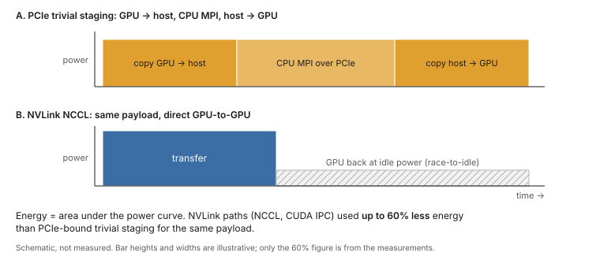
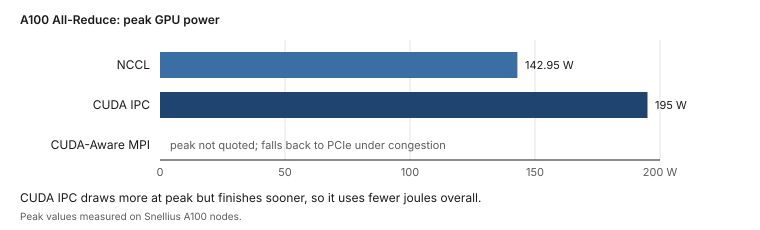

As language models grow to hundreds of billions of parameters, training clusters get so large that communication is no longer only a latency problem. It shows up on the power bill too.

I used the async power profiler from my earlier GPU work on *Snellius* to measure power and memory use on **NVIDIA A100 (Ampere)** and **H100 (Hopper)** nodes, comparing **NVLink**, **PCIe**, **CUDA-Aware MPI**, and **NCCL**.

---

## The Testing Topology
Two node types:
*   **A100 SXM4 node:** 4x A100 (40GB HBM2), linked by **NVLink Gen3** (4 links per GPU, theoretical 100 GB/s bidirectional).
*   **H100 node:** 4x H100 (94GB HBM3), linked by **NVLink Gen4** (up to 160 GB/s per device for peer-to-peer).

Four ways to move data:
1.  **Trivial Staging:** copy GPU → host, send with CPU MPI, copy host → target GPU.
2.  **CUDA-Aware MPI:** pass GPU pointers straight to MPI; the runtime moves data directly via UCX.
3.  **NCCL:** NVIDIA's proprietary collective library.
4.  **CUDA IPC:** direct memory access between GPUs on the same node over NVLink.

---

## Finding 1: NVLink Saves Energy
**NVLink** has higher bandwidth and lower latency than **PCIe**, so transfers finish sooner. The GPU drops back to idle power earlier. Architects call this **"race-to-idle."**

NVLink paths via **NCCL** or **CUDA IPC** used **up to 60%** less total energy than PCIe-bound Trivial Staging for the same payloads.

---

## Finding 2: Power by Communication Pattern
We profiled **Peer-To-Peer (PP)**, **All-To-All (A2A)**, and **All-Reduce (AR)** for payloads up to 0.5 GB.

### 1. Peer-To-Peer
NCCL and CUDA IPC drew the least power. **CUDA IPC** was lowest: it skips the CPU and MPI entirely and runs `cudaMemcpyPeer` directly over NVLink.

### 2. Collectives: All-To-All and All-Reduce
With more complex patterns, the power gaps grew.

In an A100 `All-Reduce`, **NCCL** peaked at **142.95W** and **CUDA IPC** at **195W**. CUDA IPC draws more at peak because it uses memory and links hard, but it finishes much sooner, so it uses fewer joules overall.

---

## Finding 3: Memory and SM Utilization
With DCGM counters we tracked **SM Activity** (`DCGM_FI_PROF_SM_ACTIVE`) and **SM Occupancy** during transfers. Two patterns stood out:
*   **NCCL:** in `All-Reduce`, SM activity peaked around 16%. Its topology-aware algorithms keep SMs busy just enough to drive the transfer, without wasting compute.
*   **CUDA-Aware MPI falls back to PCIe:** in complex collectives, it switched from NVLink to PCIe when queues congested. SM activity dropped toward 0% while the GPU waited on PCIe. I saw the same pattern in the UCX bandwidth work, this time through a power meter.

---

## A100 vs. H100
The **H100** was much more stable in power and runtime.

The A100 showed variable power drops in containers. The H100 kept power and performance closely matched between native and containerized runs. This suggests Hopper's memory controllers and NVSwitch fabric handle virtualization overhead much better.

## Takeaways
1.  **Race to idle:** to cut energy in large GPU clusters, maximize throughput with **NCCL** or **CUDA IPC** so GPUs return to idle quickly.
2.  **Watch your interconnects:** compare DCGM counters (`DCGM_FI_PROF_PCIE_TX_BYTES` vs. `DCGM_FI_PROF_NVLINK_TX_BYTES`) to check that MPI is not quietly sending collectives over PCIe under congestion.
3.  **Pick hardware for predictability:** if budget predictability matters, the **H100** gives a much steadier power-to-performance profile in containers than the A100.

---

### References

* Lang & Rünger, *High-Resolution Power Profiling of GPU Functions Using Low-Resolution Measurement* (Euro-Par 2013). [DOI](https://doi.org/10.1007/978-3-642-40047-6_80)
* De Sensi et al., *Exploring GPU-to-GPU Communication: Insights into Supercomputer Interconnects* (IEEE SC24). [arXiv:2408.14090](https://arxiv.org/abs/2408.14090)
* Full list: [All references](/readinglist/).
