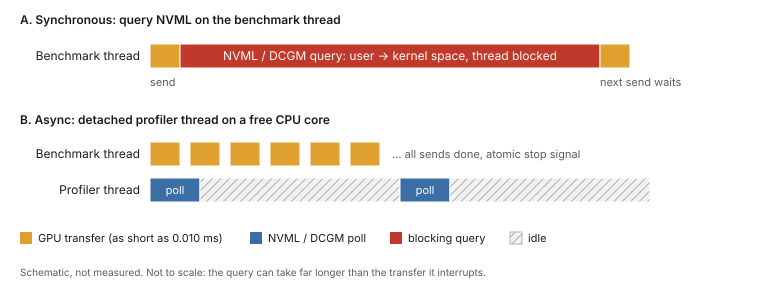
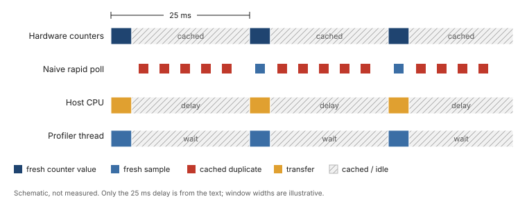

A frustrating part of performance engineering is the **observer effect**: profiling a system can change how it behaves. This is especially true for fast GPU communication, where transfers finish in microseconds.

While studying the energy cost of GPU interconnects on NVIDIA A100 and H100 devices, I kept hitting the same problem. High-level profilers like PAPI, Likwid, or NVIDIA Nsight either lacked permissions in multi-tenant environments or added too much overhead. Calling the NVML and DCGM APIs synchronously during small transfers (1-byte to 1-kilobyte messages) visibly lowered the bandwidth I was trying to measure.

This post covers the async, detached profiler I built to avoid that.

## The Problem: Querying the Driver Is Expensive
The **NVIDIA Management Library (NVML)** and **NVIDIA Data Center GPU Manager (DCGM)** work close to the driver.

A synchronous metric query switches from user space to kernel space. In micro-benchmarks like Peer-to-Peer CUDA IPC transfers, which can take as little as `0.010ms`, the query itself can take longer than the benchmark and skew the bandwidth results.



## The Fix: An Asynchronous Detached Profiler

I separated the benchmark from the metric polling.

### 1. A Detached Thread
The profiler lives in its own C++ header, outside the GPU communication loop. The main thread starts the benchmark and immediately spawns a detached thread on a free CPU core.

```
// Detached thread initialization inside the benchmark harness
void start_power_profile(std::string experiment_name, int device_id) {
    std::thread profiler_thread([=]() {
        // Run NVML/DCGM loop on a separate CPU core
        run_async_profiler(experiment_name, device_id);
    });
    profiler_thread.detach(); // Free the master thread to run the CUDA benchmark
}
```

When all GPU transfers finish, an atomic signal from the main thread stops the profiler loop and joins the collection thread.

### 2. A 25ms Delay Between Transfers
A separate thread is not enough. If it queries NVML as fast as it can, it wastes CPU cycles and creates driver bottlenecks.

Also, NVIDIA's hardware counters update at a limited rate. The driver answers at any time, but most answers are **cached duplicates**: 50 queries in under 20ms mostly return the same value, so you burn CPU for a flat line.

So I added a **25ms delay between transfers** in the benchmark loop. The goal is not more samples; it is **more fresh samples**:
1.  Transfers and profiler polls land near hardware updates instead of in long cached stretches.
2.  We got detailed, changing power curves instead of a flat line of cached data.
3.  The CPU cost of driver queries stayed close to zero.



## NVML vs. DCGM
We used each library for what it does best:

| Library / Metric | API Call / Counter ID | Best Used For |
| :--- | :--- | :--- |
| **NVML** Power Draw | `nvmlDeviceGetPowerUsage` | Real-time GPU + Memory power draw (W) |
| **NVML** Memory | `nvmlDeviceGetMemoryInfo` | Active memory footprint |
| **DCGM** PCIe Link | `DCGM_FI_PROF_PCIE_TX_BYTES` | Tracking fallback traffic over PCIe |
| **DCGM** NVLink | `DCGM_FI_PROF_NVLINK_TX_BYTES`| Measuring real NVLink link utilization |
| **DCGM** SM Active | `DCGM_FI_PROF_SM_ACTIVE` | Streaming Multiprocessor activity ratio |

Wrapped in a small C++ class that writes per-device CSV files, this was flexible enough to chase the PCIe fallback I later wrote about in the UCX post. I have not run it inside a fully contained Apptainer image yet; that is probably where permissions get ugly again.

## Design Lessons
1.  **Keep profiling off the hot path:** use detached threads on unused CPU cores.
2.  **Respect the counter update rate:** querying faster than counters update gives duplicates and adds driver latency. Add delays that match the hardware's sampling rate.
3.  **Compare against a baseline:** run once without the profiler. If the profiled bandwidth matches, you avoided the observer effect.

---

### References

* Lang & Rünger, *High-Resolution Power Profiling of GPU Functions Using Low-Resolution Measurement* (Euro-Par 2013). [DOI](https://doi.org/10.1007/978-3-642-40047-6_80)
* De Sensi et al., *Exploring GPU-to-GPU Communication: Insights into Supercomputer Interconnects* (IEEE SC24). [arXiv:2408.14090](https://arxiv.org/abs/2408.14090)
* Full list: [All references](/readinglist/).

---
