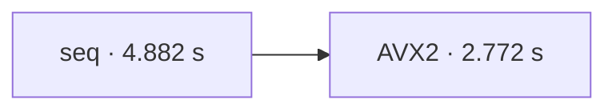
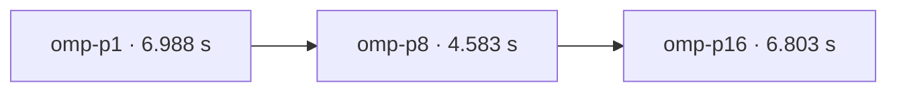

I keep a small **8-neighbor heat stencil** around as a sanity check: conductivity-weighted update with
`DIRECT = (√2/(√2+1))/4` on cardinal neighbors and `DIAG = (1/(√2+1))/4` on diagonals, double-buffered temperatures, fixed iteration count. Same math, four runtimes (seq, hand SIMD, OpenMP, pthreads). On this box the surprise was not SIMD (expected win) but **OpenMP losing to pthreads** once threads actually help.

Reporting is three short ladders at fixed size (**1000×1000**, **2000** iterations), not one ranking that mixes unrelated knobs.

## Setup

| Item | Value |
|------|--------|
| Grid | 1000×1000, 2000 iterations |
| Input | `areas_1000x1000.pgm`, tolerance `e=1e-4` |
| Compiler | gcc 15.3, `-O3 -march=native` (all variants) |
| OpenMP env | `OMP_PROC_BIND=true`, `OMP_WAIT_POLICY=active` |

SIMD path: `immintrin.h`, **`__m256d`**, `VEC_LENGTH=4`, **`ALIGN=64`**. OpenMP: `#pragma omp for nowait` on the interior, **`critical`** when reporting global min/max; team fork/join **every outer iteration**. Pthreads: barrier between halo and interior phases, **`mutex`** on the reduction.

---

## Performance for 1000×1000 heat stencil

Same grid and iteration count everywhere. Each ladder changes one knob. Times and FLOP/s are program-reported from the benchmark stdout.

### Ladder A: vectorize the hot loop

| Step | Variant | Time (s) | FLOP/s | vs seq |
|------|---------|----------|--------|--------|
| 1 | seq | 4.882 | 4.92e9 | 1.00× |
| 2 | simd AVX2 | 2.772 | 8.66e9 | 1.76× |



### Ladder B: pthreads thread count

| Step | Variant | Time (s) | FLOP/s | vs pth-p1 |
|------|---------|----------|--------|-----------|
| 1 | pth -p1 | 5.859 | 4.10e9 | 1.00× |
| 2 | pth -p8 | 2.190 | 1.10e10 | 2.67× |
| 3 | pth -p16 | 3.110 | 7.72e9 | 1.88× |


Eight threads is the peak. Sixteen goes backwards (still faster than `-p1`, slower than `-p8`).

### Ladder C: OpenMP thread count

| Step | Variant | Time (s) | FLOP/s | vs seq |
|------|---------|----------|--------|--------|
| 1 | omp -p1 | 6.988 | 3.43e9 | 0.70× |
| 2 | omp -p8 | 4.583 | 5.24e9 | 1.07× |
| 3 | omp -p16 | 6.803 | 3.53e9 | 0.72× |



`-p1` is already worse than seq (fork/join tax with no parallel payoff). `-p8` barely clears seq. `-p16` regresses below seq again.

Best overall across ladders: **pthreads at 8 threads** (~2.2× vs seq, ~1.10e10 FLOP/s). Raw dump if you want the full matrix in one place:

```text
$ # excerpt from benchmark stdout (2000 iters, 1000x1000)
variant          Time(s)    FLOP/s
seq              4.882      4.92e9
simd AVX2        2.772      8.66e9
omp -p1          6.988      3.43e9
omp -p8          4.583      5.24e9
omp -p16         6.803      3.53e9
pth -p1          5.859      4.10e9
pth -p8          2.190      1.10e10
pth -p16         3.110      7.72e9
```

---

## SIMD and a reduction bug

Vectorized interior updates behaved: min/max matched the sequential reference. The printed **`T_diff`** did not (order **6.7** vs ~**0.0047**). Same reduction path, wrong aggregate, classic **reduction bug** while the field statistics were fine. I still trust the timing loop; I do not trust that one diff line until the reduction is fixed.

---

## Why OpenMP lost to pthreads

The dominant cost on this micro-benchmark is **fork/join tax**. Creating or waking an OpenMP team **2000 times** (once per time step) buys little when each step is already cache-friendly work split across rows. Pthreads stay alive; they hit a **barrier** per iteration but skip repeated team setup. OpenMP `-p1` at **6.988 s** is worse than seq (**4.882 s**) for the same reason: lifecycle overhead with no parallel payoff.

At 8 threads, pthreads overlap interior rows cleanly after the halo barrier. OpenMP's `-p8` (**4.583 s**) only nudges past seq because parallel row work and **`nowait`** help, but not enough to catch AVX2 or pth-8.

At 16 threads, both parallel runtimes contend (memory bandwidth, false sharing on halos, barrier skew). OpenMP's regression is sharper (**6.803 s**); pthreads still win (**3.110 s**) but leave performance on the table vs 8 threads.

---

## Connection

The stencil is memory-bound at this grid size; the ranking is mostly **how much synchronization you pay per iteration**, not FLOP count. That rhymes with playing cache hierarchy in simulation ([Simulating a cache with SystemC](/blog/Simulating-a-cache-with-SystemC/)): here the "model" is the runtime, and the expensive events are barriers and team lifecycle, not the multiply-adds.

---

## Takeaways

1. **Vectorize the hot loop first** on CPU: AVX2 cut time ~43% with no threads.
2. **Measure at the thread count that matches the machine**, not "more is better": 16 threads hurt OpenMP; pth peaked at 8.
3. **OpenMP inside a time-step loop** needs a persistent parallel region or `omp parallel` around the whole iteration nest; per-step fork/join ate the win here.
4. **Validate reductions separately** from timings; a wrong `T_diff` would have sent me on a wild goose chase.
5. For fair runtime shootouts, report **wall time and a derived FLOP/s** together; my OpenMP FLOP/s at `-p1` looks artificially low because time blew up on overhead.

Anyway, next step on this problem is one OpenMP variant with a **single parallel region** over all 2000 steps and a proper parallel reduction for diff, then rerun the same table.
