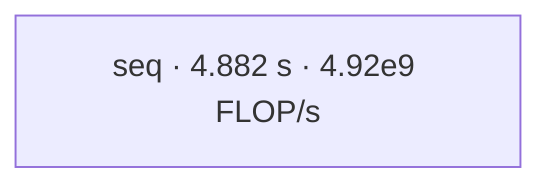
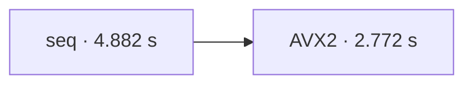
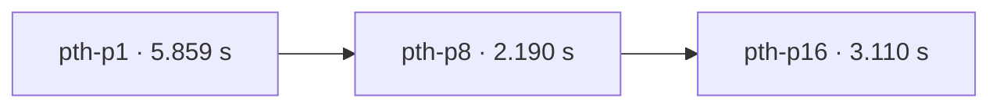
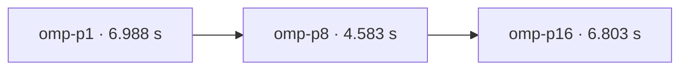

I keep a small **8-neighbor heat stencil** around as a sanity check: conductivity-weighted update with
`DIRECT = (√2/(√2+1))/4` on cardinal neighbors and `DIAG = (1/(√2+1))/4` on diagonals, double-buffered temperatures, fixed iteration count. Same math, four runtimes (seq, hand SIMD, OpenMP, pthreads). On this box the surprise was not SIMD (expected win) but **OpenMP losing to pthreads** once threads actually help.

Fixed size throughout: **1000×1000**, **2000** iterations. Each step below adds one result and keeps the earlier ones in the same table.

## Setup

| Item | Value |
|------|--------|
| Grid | 1000×1000, 2000 iterations |
| Input | `areas_1000x1000.pgm`, tolerance `e=1e-4` |
| Compiler | gcc 15.3, `-O3 -march=native` (all variants) |
| OpenMP env | `OMP_PROC_BIND=true`, `OMP_WAIT_POLICY=active` |

SIMD path: `immintrin.h`, **`__m256d`**, `VEC_LENGTH=4`, **`ALIGN=64`**. OpenMP: `#pragma omp for nowait` on the interior, **`critical`** when reporting global min/max; team fork/join **every outer iteration**. Pthreads: barrier between halo and interior phases, **`mutex`** on the reduction.

---

## Performance for 1000×1000 heat stencil

Times and FLOP/s are program-reported from the benchmark stdout.

### 1. Sequential baseline

Plain scalar double-buffered update, no threads, no SIMD. Same 2000 iterations you will see in every later bar. This is the wall-time and FLOP/s reference: if a "parallel" run cannot beat it, the runtime is eating the win.

| Variant | Time (s) | FLOP/s |
|---------|----------|--------|
| seq | 4.882 | 4.92e9 |

At this grid size the stencil is already memory-friendly. The ranking later is mostly about synchronization cost per iteration, not clever arithmetic.

### 2. Vectorize the hot loop (AVX2)

Before touching threads, vectorize the interior with hand SIMD (`__m256d`, `VEC_LENGTH=4`, 64-byte alignment). Same single-threaded control flow, same iteration count. If AVX2 does not move the needle, threading will not save a bad inner loop.

| Variant | Time (s) | FLOP/s |
|---------|----------|--------|
| seq | 4.882 | 4.92e9 |
| simd AVX2 | 2.772 | 8.66e9 |

About **1.76×** vs seq with no threads, ~**43%** less wall time. Field min/max matched the sequential reference. The printed **`T_diff`** did not (order **6.7** vs ~**0.0047**): classic reduction bug on that one aggregate while the timed loop still looks sane. I trust the timings; I do not trust that diff line until the reduction is fixed.

### 3. Pthreads: raise the thread count

Switch to persistent worker threads. Halo and interior phases meet at a barrier; a mutex guards the reduction. First check the runtime with **no** parallel payoff: one thread still pays pthreads setup and the barrier path.

| Variant | Time (s) | FLOP/s |
|---------|----------|--------|
| seq | 4.882 | 4.92e9 |
| simd AVX2 | 2.772 | 8.66e9 |
| pth -p1 | 5.859 | 4.10e9 |

`-p1` is already slower than seq. That is the tax floor. Now give the workers real row splits at 8 threads:

| Variant | Time (s) | FLOP/s |
|---------|----------|--------|
| seq | 4.882 | 4.92e9 |
| simd AVX2 | 2.772 | 8.66e9 |
| pth -p1 | 5.859 | 4.10e9 |
| pth -p8 | 2.190 | 1.10e10 |

Eight threads is the peak so far (~**2.2×** vs seq, ~**1.10e10** FLOP/s). Threads stay alive across the 2000 steps; they hit a barrier each iteration but skip rebuilding a team. Push to 16 on the same host:

| Variant | Time (s) | FLOP/s |
|---------|----------|--------|
| seq | 4.882 | 4.92e9 |
| simd AVX2 | 2.772 | 8.66e9 |
| pth -p1 | 5.859 | 4.10e9 |
| pth -p8 | 2.190 | 1.10e10 |
| pth -p16 | 3.110 | 7.72e9 |

Sixteen goes backwards: still faster than `-p1`, slower than `-p8`. Memory bandwidth, false sharing on halo edges, and barrier skew start to dominate. More threads is not free scaling on this box.

### 4. OpenMP: same thread counts, different runtime

Same grid, same iteration count, different lifecycle. This OpenMP path forks or wakes a team **every** outer time step (`#pragma omp for nowait` on the interior, `critical` on the global min/max). That is the knob that will hurt.

| Variant | Time (s) | FLOP/s |
|---------|----------|--------|
| seq | 4.882 | 4.92e9 |
| omp -p1 | 6.988 | 3.43e9 |

Worse than seq with no parallel work: fork/join tax, zero payoff. The reported FLOP/s looks artificially low because time blew up on overhead. Add threads:

| Variant | Time (s) | FLOP/s |
|---------|----------|--------|
| seq | 4.882 | 4.92e9 |
| omp -p1 | 6.988 | 3.43e9 |
| omp -p8 | 4.583 | 5.24e9 |

Barely clears seq. Parallel row work and `nowait` help a little, but not enough to catch AVX2 or pth-8. Then 16:

| Variant | Time (s) | FLOP/s |
|---------|----------|--------|
| seq | 4.882 | 4.92e9 |
| omp -p1 | 6.988 | 3.43e9 |
| omp -p8 | 4.583 | 5.24e9 |
| omp -p16 | 6.803 | 3.53e9 |

`-p16` regresses below seq again, and the regression is sharper than pthreads. Creating or waking an OpenMP team **2000 times** buys little when each step is already short, cache-friendly work. Pthreads stay alive and only barrier; OpenMP pays team lifecycle every iteration. Best overall across the whole shootout remains **pthreads at 8 threads**.

---

## Connection

The stencil is memory-bound at this grid size; the ranking is mostly **how much synchronization you pay per iteration**, not FLOP count. That rhymes with playing cache hierarchy in simulation ([Simulating a cache with SystemC](/blog/Simulating-a-cache-with-SystemC/)): here the "model" is the runtime, and the expensive events are barriers and team lifecycle, not the multiply-adds.

---

## Takeaways

1. **Vectorize the hot loop first** on CPU: AVX2 cut time ~43% with no threads.
2. **Measure at the thread count that matches the machine**, not "more is better": 16 threads hurt OpenMP; pth peaked at 8.
3. **OpenMP inside a time-step loop** needs a persistent parallel region or `omp parallel` around the whole iteration nest; per-step fork/join ate the win here.
4. **Validate reductions separately** from timings; a wrong `T_diff` would have sent me on a wild goose chase.
5. For fair runtime shootouts, report **wall time and a derived FLOP/s** together; my OpenMP FLOP/s at `-p1` looks artificially low because time blew up on overhead.

Anyway, next step on this problem is one OpenMP variant with a **single parallel region** over all 2000 steps and a proper parallel reduction for diff, then rerun the same progressive tables.
