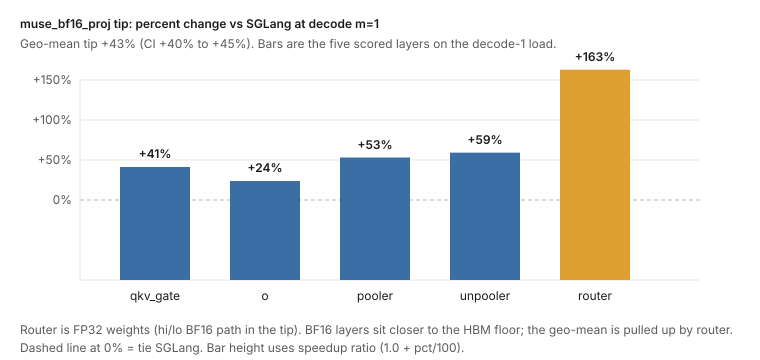

I used the [Open Kernel Challenge](https://openkernelchallenge.dev) as a bounded side project into **SGLang** on Muse Spark Open (816B MoE, ~42B active). Goal: see where a serving stack spends time on H200, and which edits matter (library GEMM, fused prep, or a custom kernel). Budget was a few remote judge runs a day. I did not expect large gains.

---

## Challenge Shape

The **kernel track** times five single-GPU cuts of one layer against SGLang on one **H200**. Score is a geo-mean over loads (0% = tie). One Python file, CUDA-graph capturable, readable GPU source built in-run; untimed `prepare()` may repack weights losslessly. The **serving track** (8×H200 SGLang patch) I barely touched.

| Board | Scope |
| :--- | :--- |
| `muse_bf16_proj` | Dense projections (qkv/gate, o, pooler, unpooler, router) |
| `muse_attention_decode` | Decode attention over FP8 paged KV |
| `muse_moe_w4a16` | Routed NVFP4 experts |
| `muse_decode_layer` | Full layer, decode / verify |
| `muse_prefill_layer` | Full layer, prefill |

Published Muse Spark prefill profiling puts **~65%** of time in routed experts. Public board reports also showed the largest gaps over SGLang on MoE-related problems (kernels still moving). Dense BF16 is older. Attention sits in between. Most of my time went to `muse_bf16_proj`.

---

## Dense BF16 Projections

**Idea.** Score `out = x @ W.T` for thin `m` (decode 1 / 16 / 32, verify up to 256) against large BF16 weights (`qkv_gate` ~36 MiB, `pooler` ~64 MiB; router FP32).

**Why it matters.** At ~4.8 TB/s HBM, those weights alone are an **8 to 14 µs** memory floor. At `m=16`, qkv intensity is ~**16 FLOP/byte** vs a ridge near **200**. Decode loads are weight-streaming problems, not MMA puzzles.

### Memory floor

For each `(layer, m)`: bytes moved, mem floor, math floor. Pooler `m=1`: ~14 µs mem vs ~0.07 µs math. Qkv `m=16`: still ~8 µs mem-bound. Only the largest verify shapes approach compute-bound.

**Result.** Dropped ideas that could not beat the floor before they cost a submit.

### Baseline profiles

- **`m=1`:** SGLang Hopper GEMV, one launch, near the memory floor. Local headroom ~**6 to 15%** if you win cleanly. Custom scalar / weak WGMMA paths lost.
- **`m=16`:** cuBLAS **nvjet**. Qkv/pooler often = GEMM + **splitKreduce** (10 to 18% of time). `o` / `unpooler` often skip reduce → little headroom. No overlapping launches inside the timed graph; no precision drop under the rules.

**Result.** Headroom is cast/launch tax (router) or the reduce, not "rewrite nvjet."

### Attempts and tip

**CUTLASS sm90 stream-K / WGMMA.** Library path closer to the metal than a hand kernel. Logic: if nvjet leaves reduce tax, a tuned stream-K shape might win. Result: still lost to nvjet on most `m>1` shapes.

**Hand WGMMA + `cp.async`.** Own the mainloop. Logic: remove framework overhead and pick tiles for thin `m`. Result: below nvjet; not worth the submit budget.

**Triton stream-K.** Faster iteration than CUDA. Logic: same split-K idea as CUTLASS, cheaper to search. Result: same story; nvjet wins when the problem is weight streaming.

**Scalar FP32 router.** Router is tiny vs qkv/pooler; a simple kernel might beat launch + cast tax. Logic: avoid BF16 round-trip on a small matmul. Result: lost.

**Router hi/lo BF16 with FP32 accumulate.** Keep BF16 traffic, accumulate in FP32. Logic: match the board dtype while cutting cast/launch waste. Result: helped; largest single-layer tip later.

**Piecewise dispatch.** Route small-`m`, `m=32`, qkv, and wide o/unpooler to different paths (including pinned cuBLASLt where the floor is already tight). Logic: one kernel cannot win every shape; only override where profiles show tax. Result: tip strategy.

Most `m>1` custom GEMMs lost to nvjet. Tip kept the library path where it sits on the floor and spent custom work on remaining tax (especially **router**).

| Layer (decode m=1) | vs SGLang |
| :--- | ---: |
| qkv_gate | +41% |
| o | +24% |
| pooler | +53% |
| unpooler | +59% |
| router | +163% |
| **Geo-mean (all loads)** | **+43%** (CI +40% to +45%) |

**Next.** Treat BF16 rewrite as last resort when profiles already show one near-SOL GEMM; spend budget on MoE boards instead.

---

## Attention Decode

**Idea.** Younger stack (FA3, Flash-Decoding, Sage-style FP8 Q, paged KV). Fuse or retile around SGLang's attend instead of replacing it.

**Why it matters.** More baseline headroom than dense BF16, but FA3 still owns the timeline.

Each run below kept FA3 as the attend kernel unless noted. Goal was to find tax *around* attend, not to rewrite it.

**Flash-Decoding `num_splits`** (−1%)

Tune how many KV splits Flash-Decoding uses per query. Logic: wrong split count can leave SMs idle or over-launch reduce. Result: baseline was already near the sweet spot; retuning lost a bit.

**`page_size=1` flatten** (~0%)

Materialize paged KV into a contiguous layout before attend. Logic: remove gather / page-table indirection if that was the tax. Result: no win; paging cost was not the bottleneck on this board.

**Sage-style FP8 Q** (+3%)

Quantize Q to FP8 before FA3 (SageAttention-style), keep KV as the board already serves it. Logic: cut Q traffic and maybe open a faster FA3 path. Result: small gain; still FA3-dominated.

**FA3 + fused prep / epilogue** (+8%)

Fuse QK-RMSNorm, RoPE, and FP8 store on the way in; fuse RMSNorm×gate on the way out. Logic: those launches are real wall time even when FA3 owns ~95% of the GPU. Result: first clear win without touching the mainloop.

**Custom Triton sliding mega-fuse** (−55%)

Replace FA3 with a hand Triton kernel that tries to fuse more of the sliding window path. Logic: if prep tax matters, maybe a full rewrite does too. Result: lost badly. FA3's Cutlass mainloop is not the place to "just rewrite."

**ThunderKittens tiles on fuse tip** (+10%)

Keep the fused prep/epilogue tip; retile the TK / FA3-adjacent pieces for better occupancy. Logic: once fusion is in, tile shape is the remaining free variable. Result: another few points on top of fusion.

**Tip submit** (+15%, CI +13% to +17%)

Best of the ladder: FA3 kept, fused prep/epilogue, tile sizing. Every positive run still spent **~95%+** of GPU time in FA3 Cutlass.

**Next.** Keep FA3; wire the fused prep/epilogue into the full decode-layer board.

---

## Patching Strike Points

1. Roofline the shape first. If bytes / peak BW match baseline wall time, stop.
2. If one Cutlass/nvjet kernel owns ~95% of time, fuse prep/epilogue or fix dispatch; do not rewrite the mainloop first.
3. Enforce CUDA-graph constraints before timing (no host sync, no value-dependent allocs, no illegal overlap).
4. MoE / NVFP4 left the most room over SGLang in public reports; that board is the better second pass.

**Next with more budget:** `muse_moe_w4a16` (`prepare()` layouts, swap-AB for small token counts), then fold attention fusions into `muse_decode_layer`.

---

## Takeaways

1. Thin-M BF16 proj on H200 is mostly streaming `W`.
2. Best submits kept nvjet/FA3 and removed tax around them (+43% proj tip, +15% attn tip).
3. MoE boards had more leeway because those kernels are still young.
4. A few H200 shots are enough to map where SGLang is worth patching.

---

### References

* Paradigm / Meta / Andromeda, [Muse Spark Open Kernel Challenge](https://openkernelchallenge.dev).
* Paradigm, [challenge announcement](https://www.paradigm.xyz/writing/muse-spark-open-kernel-challenge).
* SGLang Muse Spark Open kernels (`baseline.py` per board).
* Dao et al., *FlashAttention-3* (2024).
* Hong / Dao, *Flash-Decoding* (2023).
* Zhang et al., *SageAttention* (2024).
* Kwon et al., *PagedAttention* (SOSP 2023).
