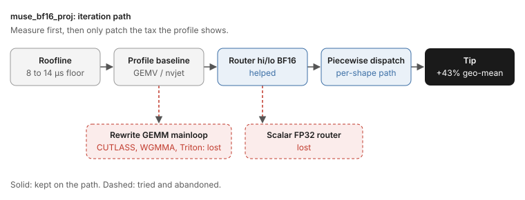
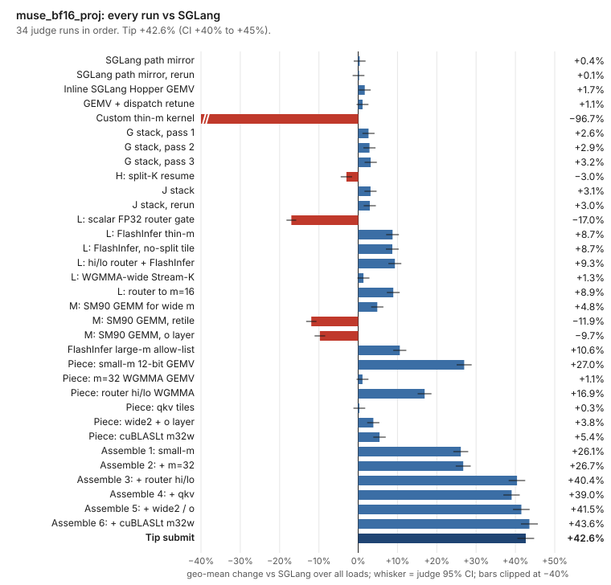
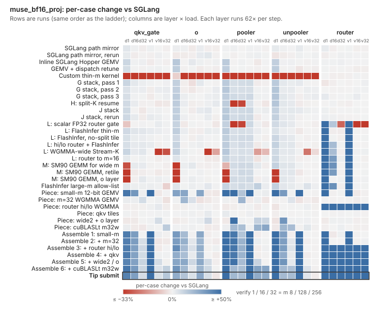
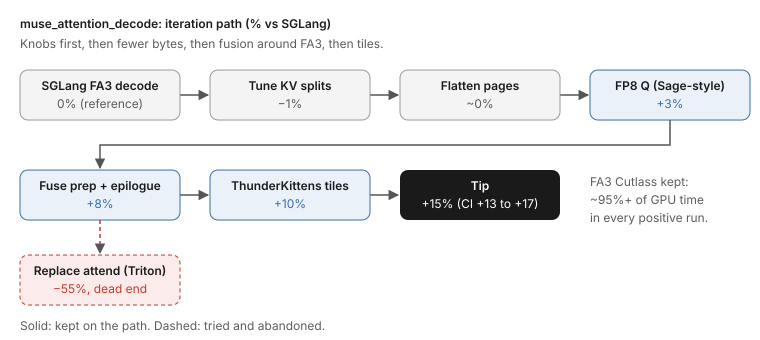
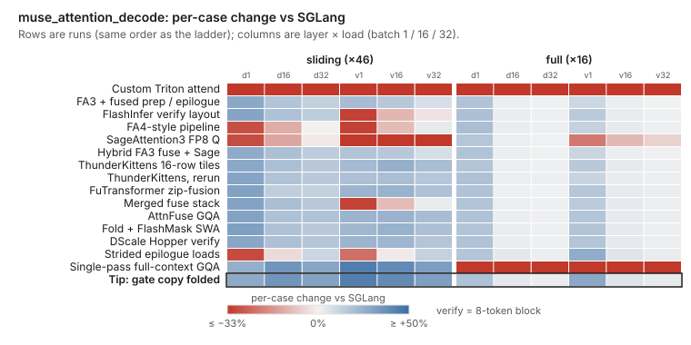
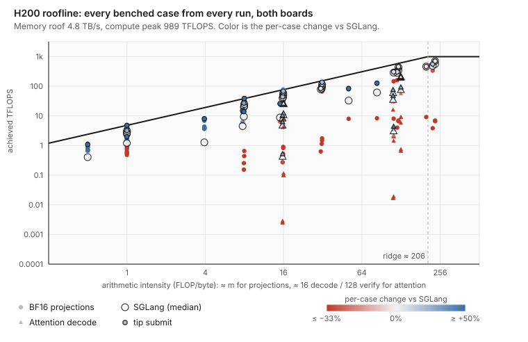

I used the [Open Kernel Challenge](https://openkernelchallenge.dev) as a bounded side project into **SGLang** on Muse Spark Open (816B MoE, ~42B active). Goal: see where a serving stack spends time on H200, and which edits matter (library GEMM, fused prep, or a custom kernel). Budget was a few remote judge runs a day. I did not expect large gains.

**Disclaimer.** Literature search, fast experiment iteration, and help implementing the papers I landed on were assisted by Cursor AI agents. All of that ran inside one $20 Cursor subscription; I used roughly half the included Composer 2.5 / Grok 4.7 quota.

---

## Challenge Shape

The **kernel track** times five single-GPU cuts of one layer against SGLang on one **H200**. Score is a geo-mean over loads (0% = tie). One Python file, CUDA-graph capturable, readable GPU source built in-run; untimed `prepare()` may repack weights losslessly. The **serving track** (8×H200 SGLang patch) I barely touched.

| Board | Scope |
| :--- | :--- |
| `muse_bf16_proj` | Dense projections (qkv/gate, o, pooler, unpooler, router) |
| `muse_attention_decode` | Decode attention over FP8 paged KV |
| `muse_moe_w4a16` | Routed NVFP4 experts |
| `muse_decode_layer` | Full layer, decode / verify |
| `muse_prefill_layer` | Full layer, prefill |


Published Muse Spark prefill profiling puts **~65%** of time in routed experts. Public board reports also showed the largest gaps over SGLang on MoE-related problems (kernels still moving). Dense BF16 is older. Attention sits in between. Most of my time went to `muse_bf16_proj`.

---

## Dense BF16 Projections

**Idea.** Score `out = x @ W.T` for thin `m` (decode 1 / 16 / 32, verify up to 256) against large BF16 weights (`qkv_gate` ~36 MiB, `pooler` ~64 MiB; router FP32).

**What is timed.** Each call is one layer, one `m`, one `config`:

```python
class Inputs(TypedDict):
    x: torch.Tensor  # bfloat16 [m, k]
    config: Config


class Weights(TypedDict):
    qkv_gate: torch.Tensor  # bfloat16 [2304, 8192]
    o: torch.Tensor         # bfloat16 [8192, 1024]
    pooler: torch.Tensor    # bfloat16 [4096, 8192]
    unpooler: torch.Tensor  # bfloat16 [8192, 4096]
    router: torch.Tensor    # float32 [256, 8192]


class Config(TypedDict):
    m: int
    # output width; the unpooler's is 1024 up to 8 tokens (this GPU's
    # slice), else 8192
    n: int
    k: int
    # which weight: "qkv_gate", "o", "pooler", "unpooler" or "router"
    layer: str
```

| Layer | Weight [rows, k] | Bytes | Floor at 4.8 TB/s | Intensity at m |
| :--- | :--- | ---: | ---: | :--- |
| `qkv_gate` | [2304, 8192] bf16 | 36 MiB | 7.9 µs | ≈ m |
| `o` | [8192, 1024] bf16 | 16 MiB | 3.5 µs | ≈ m |
| `pooler` | [4096, 8192] bf16 | 64 MiB | 14.0 µs | ≈ m |
| `unpooler` | [8192, 4096] bf16 | 64 MiB (8 MiB when n = 1024) | 14.0 µs (1.7 µs for m ≤ 8) | ≈ m |
| `router` | [256, 8192] fp32 | 8 MiB | 1.7 µs | ≈ m / 2 |

Floor = `max(bytes / 4.8 TB/s, flops / 989 TFLOP/s)`. Intensity is FLOPs (`2·m·n·k`) over bytes moved, which is roughly `m` because the weight dominates the traffic. The router is FP32, so its weight costs twice the bytes per FLOP.

The judge's table ([`muse_bf16_proj/TASK.md`](https://github.com/0chonko/open-kernel-challenge/blob/main/muse_bf16_proj/TASK.md)) maps loads to `m`: decode 1 / 16 / 32 uses `m` = 1 / 16 / 32, and verify 1 / 16 / 32 uses `m` = 8 / 128 / 256. Each layer runs **62** times per step. Unpooler at `m` ≤ 8 uses this GPU's `n = 1024` slice (1.7 µs floor); larger `m` reads the full 8192-wide weight.

**Scoring.** A load's time is the sum of its layers' times, each times its weight. Speedup is the geo-mean over loads, so each load counts equally. Timing replays CUDA graphs with a cold L2, against SGLang in paired runs. Correctness is relative L2 at most 1% against FP64, and 0.01% for the router. The router needs a BF16 hi + lo split with FP32 accumulation above 8 tokens. About one row in eight is a single power-of-two entry and must be within 0.1%.

**Why it matters.** At ~4.8 TB/s HBM, those weights alone are an **8 to 14 µs** memory floor. At `m=16`, qkv intensity is ~**16 FLOP/byte** vs a ridge near **200**. Decode loads are weight-streaming problems, not MMA puzzles.

### Memory floor

For each `(layer, m)`: bytes moved, mem floor, math floor. Pooler `m=1`: ~14 µs mem vs ~0.07 µs math. Qkv `m=16`: still ~8 µs mem-bound. Only the largest verify shapes approach compute-bound.

Intensity is about **m** (the router is about m/2). Every run is placed on the roof in Figure 8 at the end.

**Result.** Dropped ideas that could not beat the floor before they cost a submit.

### Baseline profiles

- **`m=1`:** SGLang Hopper GEMV, one launch, near the memory floor. Local headroom ~**6 to 15%** if you win cleanly. Custom scalar / weak WGMMA paths lost.
- **`m=16`:** cuBLAS **nvjet**. Qkv/pooler often = GEMM + **splitKreduce** (10 to 18% of time). `o` / `unpooler` often skip reduce → little headroom. No overlapping launches inside the timed graph; no precision drop under the rules.

**Result.** Headroom is cast/launch tax (router) or the reduce, not "rewrite nvjet."

### Iteration path



Board score is still `out = x @ W.T` for thin `m`. I sent 34 judge runs at this board (Figure 3). For most of them I tried to replace or retile the library GEMM, and they landed around parity or worse. The win came late, once I stopped hunting for one kernel and built the stack from pieces measured one at a time.

### Tip (+43%)

Code: [`submission.py` @ a132ea6](https://github.com/0chonko/open-kernel-challenge/blob/a132ea6/muse_bf16_proj/submission.py) (assembled stack), [`main`](https://github.com/0chonko/open-kernel-challenge/blob/main/muse_bf16_proj/submission.py).

Keep the library path wherever it already sits on the floor and use custom kernels only where the profile shows leftover tax. Each piece first ran alone on top of the SGLang baseline, then went onto the stack one at a time:

| Piece | Alone | Stacked |
| :--- | ---: | ---: |
| Small-`m` GEMV, 12-bit lossless + BF16 twin, `m` ≤ 32 | +27% | +26% |
| `m=32` WGMMA / TMA GEMV ([`53f3a0a`](https://github.com/0chonko/open-kernel-challenge/blob/53f3a0a/muse_bf16_proj/submission.py)) | +1% | +27% |
| Router hi/lo BF16 on WGMMA | +17% | +40% |
| qkv tiles | +0% | +39% |
| wide2 + `o` layer | +4% | +42% |
| cuBLASLt `m32w` | +5% | +44% |

Two pieces carry almost all of it. The small-`m` GEMV repacks weights to 12 bits in the untimed `prepare()` (lossless on these weights), so decode loads read fewer bytes than the BF16 floor assumes; on its own it hit 5.6× on router verify `m=8` and 1.5× on pooler `m=1`. The router piece splits each FP32 weight into two BF16 halves and accumulates in FP32:

```text
W ≈ W_hi + scale * W_lo      # both BF16
out = (x @ W_hi.T) + scale * (x @ W_lo.T)   # FP32 acc
```

That's BF16 tensor-core throughput without giving up the 0.01% router tolerance. The other four pieces are small, and qkv tiles did nothing measurable; I kept them anyway because the full stack was the best run. The tip submit scored **1.43×** (CI 1.41 to 1.45), a hair under assemble step 6, which is noise at this CI width. At decode `m=1`, pooler is already near SOL (~14.0 µs yours vs 14.0 µs floor); router is still ~2.2× the floor after the hi/lo win, so launch and cast tax still matter there.





| Layer (decode m=1) | vs SGLang | Yours / floor |
| :--- | ---: | ---: |
| qkv_gate | +41% | 1.3× |
| o | +24% | 1.5× |
| pooler | +53% | 1.0× |
| unpooler | +59% | 2.4× (n = 1024 slice) |
| router | +163% | 2.2× |
| **Geo-mean (all loads)** | **+43%** (CI +41% to +45%) | |

### The rest of the ladder

One line per run in Figure 3, in order (reruns merged).

| Run | vs SGLang | What it tried |
| :--- | ---: | :--- |
| SGLang path mirror (×2) | 0% | Baseline dispatch copied as is; sets the noise band at about ±1.5%. |
| Inline SGLang Hopper GEMV | +2% | `load_inline` SGLang's `hopper_bf16_gemv` for `m=1`. |
| GEMV + dispatch retune | +1% | Moved which shapes take the GEMV. |
| Custom thin-m kernel | −97% | Scalar BF16 GEMV for `m` = 8 to 32; nowhere near nvjet. |
| G stack (3 passes) | +3% | Inline GEMV, one-launch CUDA router for `m` ≤ 8 ([`3013eec`](https://github.com/0chonko/open-kernel-challenge/blob/3013eec/muse_bf16_proj/submission.py)), FlashInfer only where it beat nvjet. |
| H: split-K resume | −3% | One-launch WMMA Stream-K on thin qkv / pooler / unpooler to skip nvjet's split-K reduce ([`f445cc7`](https://github.com/0chonko/open-kernel-challenge/blob/f445cc7/muse_bf16_proj/submission.py), [sketch](https://github.com/0chonko/open-kernel-challenge/blob/main/papers/sketches/stream-k-work-centric-parallel-decomposition-for-dense/gemm_kernel.cu.pp)). |
| J stack (×2) | +3% | G stack with the ThunderKittens WMMA kernel switched off. |
| L: scalar FP32 router gate | −17% | Plain FP32 router kernel to skip the cast round-trips. |
| L: FlashInfer thin-m (×2) | +9% | FlashInfer tensor-core `mm_bf16` for thin `m`, FP32 router gated to `m` ≤ 8. |
| L: hi/lo router + FlashInfer | +9% | First hi/lo BF16 router above 8 tokens ([`d60f62b`](https://github.com/0chonko/open-kernel-challenge/blob/d60f62b/muse_bf16_proj/submission.py)). |
| L: WGMMA-wide Stream-K | +1% | Router split across 256 CTAs, WGMMA `m64n128k16` at `m=256`. |
| L: router to m=16 | +9% | FP32 router path extended to `m=16`. |
| M: SM90 GEMM for wide m, retile | +5%, −12% | CUTLASS SM90 GEMM on the verify shapes; the retile lost. |
| M: SM90 GEMM, o layer | −10% | Same, plus a packed GEMV at `m=1` that lost decode badly (qkv 0.22×). |
| FlashInfer large-m allow-list | +11% | FlashInfer widened to large `m`; best run before the piecewise rebuild. |

Every hand-written mainloop lost to nvjet on `m` > 1. The job is streaming `W`, not inventing a better MMA.

**Next.** Treat BF16 rewrite as last resort when profiles already show one near-SOL GEMM; spend budget on MoE boards instead.

---

## Attention Decode

**Idea.** Younger stack (FA3, Flash-Decoding, Sage-style FP8 Q, paged KV). Fuse or retile around SGLang's attend instead of replacing it.

**Why it matters.** More baseline headroom than dense BF16, but FA3 still owns the timeline.

**What is timed.** One call is one GQA attention layer for one decode step or one 8-token verify block:

```python
class Inputs(TypedDict):
    qkv: torch.Tensor            # bfloat16 [B, L, (2*Hq + 2*Hkv)*64]
    positions: torch.Tensor      # int64 [B*L]
    cache_loc: torch.Tensor      # int64 [B*L], flat cache row per new token
    cache_seqlens: torch.Tensor  # int32 [B], seq_lens + L
    cu_seqlens_q: torch.Tensor   # int32 [B+1], 0, L, 2L, ...
    scheduler_metadata: torch.Tensor | None  # FA3 tile schedule, full-attention decode only
    k_cache: torch.Tensor        # float8_e4m3fn [pages, page_size, Hkv, 64], written in place
    v_cache: torch.Tensor        # float8_e4m3fn [pages, page_size, Hkv, 64], written in place
    k_scale: torch.Tensor        # float32 []
    v_scale: torch.Tensor        # float32 []
    page_table: torch.Tensor     # int32 [B, max_pages], -1 unused
    seq_lens: torch.Tensor       # int32 [B]
    config: Config


class Config(TypedDict):
    batch: int            # B
    q_len: int            # L: 1 for decode, 8 for a speculative verify block
    num_q_heads: int      # Hq: 16 per GPU under TP8
    num_kv_heads: int     # Hkv: 2
    head_dim: int         # 64
    page_size: int        # 1 in the scored cases, 64 in some tests
    window: int           # 2048 on sliding layers; 0 = full attention
    rope_theta: float     # 500000 on sliding layers; 0 = no RoPE
    qk_scale_factor: float
    sm_scale: float       # 1/8
    kv_scale: float       # 1 in the scored cases
```

Output is `bfloat16 [B, L, Hq·64]`. Scored loads are `decode {1, 16, 32}` and `verify {1, 16, 32}` (L = 8), each on a sliding layer (2,048-token window with RoPE) and a full layer (whole ~80K-token context, no RoPE). SGLang runs with speculative decoding off for decode and its default recipe for verify.

| Layer | Runs per step | Floor, B = 1 | B = 16 | B = 32 |
| :--- | ---: | ---: | ---: | ---: |
| sliding (2,048 window, RoPE) | 46 | 0.1 µs | 1.6 µs | 3.3 µs |
| full (~80K context, no RoPE) | 16 | 4.3 µs | 63.2 µs | 126.4 µs |

Floors are from the judge's table in [`muse_attention_decode/TASK.md`](https://github.com/0chonko/open-kernel-challenge/blob/main/muse_attention_decode/TASK.md). Intensity on unique KV is about **16 FLOP/byte** (`4·Hq / (2·Hkv)`), well below the ridge near 200, so the board is memory-bound at SOL. Verify reuses the same KV across 8 queries in the floor bound, so its intensity is higher than decode, but measured traffic on large full shapes still lands around **3×** the unique-KV bytes (cold L2, page gather, head reuse shortfall, epilogue).

**Scoring and rules.** Same geo-mean over loads as the projections. Each load is one `(mode, B)` with **sliding × 46 + full × 16**, so sliding tax moves the score more than shaving another percent off a huge full FA. Correctness is relative L2 against an FP32 reference, within 2.5× the FP8-query reference error plus 1.5%, clamped to 3 to 15%. New cache entries must match within 8%. The 16 pre-timing tests include data-parallel heads, a 1M-token context, page size 64, and KV scales of 1/64. Every key must be attended: no top-k, sparse, or block-skipping attention. Queries may be rounded to FP8 E4M3, as FA3 does, but the KV cache stays FP8.

**Baseline launch chain** (what SGLang pays around FA3):

```text
FusedQKNorm → store_cache → q.to(fp8) → [prepare_varlen?] → FA3 → [Combine?] → rms_norm_gate
```

Constants on scored shapes: `Hq=16`, `Hkv=2`, `D=64`, GQA=8, `page_size=1`, `kv_scale=1`, `sm_scale=1/8`, `qk_scale_factor=5.473` (FA softmax scale `5.473/8`), RoPE θ=`5e5` on sliding only. Specs and floors: [meta repo](https://github.com/0chonko/open-kernel-challenge).

### Iteration path



FA3 stays the attend kernel unless noted. I sent 16 judge runs here (Figure 6), and the hunt was for tax *around* attend.

### Tip (+15%)

Code: [`submission.py` @ 2d001cc](https://github.com/0chonko/open-kernel-challenge/blob/2d001cc/muse_attention_decode/submission.py) (FA3 fuse tip; `main` later moved to a full gated CUDA path).

The tip keeps SGLang's FA3 and stacks four edits around it:

1. **Fused prep and epilogue (+8%,** [`cdcd1a9`](https://github.com/0chonko/open-kernel-challenge/blob/cdcd1a9/muse_attention_decode/submission.py)**).** Collapse the launches around attend into one prep and one epilogue:

   ```text
   # was: rmsnorm(Q) → rope(Q) → cast_fp8(Q) → FA3 → rmsnorm(O) * gate
   Q8 = fuse_rmsnorm_rope_fp8(Q, W_q)
   O  = FA3(Q8, K_paged, V_paged)
   Y  = fuse_rmsnorm_gate(O, gate)
   ```

   Those edge kernels are real wall time even when FA3 is ~95% of the GPU.
2. **ThunderKittens 16-row tiles (+10%,** [`024b796`](https://github.com/0chonko/open-kernel-challenge/blob/024b796/muse_attention_decode/submission.py), [sketch](https://github.com/0chonko/open-kernel-challenge/blob/main/papers/sketches/thunderkittens-simple-fast-and-adorable-ai-kernels/gemm_kernel.cu.pp)**).** Once fusion is in, tile shape is the remaining free variable.
3. **DScale path tiles (+10%).** `BLOCK_M` and `num_warps` picked per path, with a larger M on big verify shapes.
4. **Fold the gate copy into the epilogue (+15%).** On short-Q verify shapes FA returns non-row-major views, and the elementwise copy after it cost ~2 to 3 µs, a whole launch. Folding it into the Triton epilogue removes it.

The tip run scored **1.15×** (CI 1.13 to 1.17). Tip launch chain:

```text
_fused_qk_rope_store → [prepare_varlen?] → FA3 → [Combine?] → [ATen?] → _rms_norm_gate_epilogue
```

| Regime | FA main share | Side tax | Yours / SOL | What limits |
| :--- | ---: | ---: | ---: | :--- |
| Sliding (all B) | ~45 to 60% | prep, combine, epi, ATen | 8 to 190× | launch / fixed cost on a short kernel |
| Full B=1 | ~55 to 60% | combine heavy | ~6 to 7× | splits + combine |
| Full B=16/32 | ~93 to 98% | tiny | ~3× | KV HBM + page gather |

Speedup is collapsing prep/epi and small FA layout wins, not beating FA's HBM by 3×. Full large-B stays within a couple percent of SGLang. Hitting SOL on sliding alone would move the geo-mean more than another percent off huge full FA.




### The rest of the ladder

One line per run in Figure 6 that isn't a tip step, in order.

| Run | vs SGLang | What it tried |
| :--- | ---: | :--- |
| Custom Triton attend | −99.8% | Own Triton attend kernel in place of FA3 ([`60f6ec6`](https://github.com/0chonko/open-kernel-challenge/blob/60f6ec6/muse_attention_decode/submission.py)). |
| FlashInfer verify layout | +0% | Dense `[B, L, Hq, D]` Q on verify, no KV split on sliding verify; sliding verify FA got ~2× slower. |
| FA4-style pipeline | −8% | Fused prep producer, `num_splits=1` on sliding, software-pipelined epilogue for verify. |
| SageAttention3 FP8 Q | −21% | Microscaled FP8 Q (the judge allows E4M3, not FP4); correct but slower. |
| Hybrid FA3 fuse + Sage | +8% | Fuse spine on scored shapes, Sage FP8 cast only for non-unity KV scales; ties the fuse. |
| ThunderKittens, rerun | +9% | Same tiles, same answer. |
| FuTransformer zip-fusion | +10% | FuTransformer's zip-fusion idea on the fuse spine. |
| Merged fuse stack | +1% | Several fuse branches in one submit; the gains didn't add up. |
| AttnFuse GQA | +10% | AttnFuse's GQA fusion on the fuse spine. |
| Fold + FlashMask SWA | +10% | FlashMask-style sliding-window masking on the fuse spine. |
| Strided epilogue loads | −4% | Epilogue reads FA's strided output directly instead of copying it first. |
| Single-pass full-context GQA | −80% | Custom kernel reading each KV byte once for all 8 query heads that share it. |

Three early probes aren't on the chart: a Flash-Decoding `num_splits` retune (−1%, [`ef3a9dc`](https://github.com/0chonko/open-kernel-challenge/blob/ef3a9dc/muse_attention_decode/submission.py)), a `page_size=1` KV flatten (~0%, [`bed4af3`](https://github.com/0chonko/open-kernel-challenge/blob/bed4af3/muse_attention_decode/submission.py)), and a Sage-style FP8 Q cast fused into QK-norm (+3%, [`9558aea`](https://github.com/0chonko/open-kernel-challenge/blob/9558aea/muse_attention_decode/submission.py)). Same pattern as the projections, honestly: every run that replaced the attend mainloop lost, some by orders of magnitude, and everything that only touched the edges landed within a few percent of each other.

**Next.** Keep FA3; wire the fused prep/epilogue into the full decode-layer board.

---

## All Experiments on One Roofline



Each mark is one `(layer, load)` case from one judge run; color is that case's change vs SGLang, rings are the SGLang median. Wins stack up against the memory roof; losses fall straight down at the same intensity, because a slower kernel does the same work in more time. The few projection points above the roof come from the 12-bit small-`m` weight packing, which moves fewer bytes than the BF16 floor assumes. Attention triangles sit well under the roof on sliding shapes, which is the launch and fixed-cost tax from the table above.

---

## Patching Strike Points

1. Roofline the shape first. If bytes / peak BW match baseline wall time, stop.
2. If one Cutlass/nvjet kernel owns ~95% of time, fuse prep/epilogue or fix dispatch; do not rewrite the mainloop first.
3. Enforce CUDA-graph constraints before timing (no host sync, no value-dependent allocs, no illegal overlap).
4. MoE / NVFP4 left the most room over SGLang in public reports; that board is the better second pass.

**Next with more budget:** `muse_moe_w4a16` (`prepare()` layouts, swap-AB for small token counts), then fold attention fusions into `muse_decode_layer`.

---

## Takeaways

1. Thin-M BF16 proj on H200 is mostly streaming `W`.
2. Best submits kept nvjet/FA3 where they sit on the floor and only replaced the tax around them: 12-bit small-`m` GEMV and hi/lo router on projections (+43%), fused edges on attention (+15%).
3. Measure pieces alone, then stack them one at a time; the projection tip only appeared once I did that.
4. MoE boards had more leeway because those kernels are still young.
5. A few H200 shots are enough to map where SGLang is worth patching.

---

### References

Challenge and code:

* Paradigm / Meta / Andromeda, [Muse Spark Open Kernel Challenge](https://openkernelchallenge.dev); [announcement](https://www.paradigm.xyz/writing/muse-spark-open-kernel-challenge).
* Meta repo notes: [`papers/`](https://github.com/0chonko/open-kernel-challenge/tree/main/papers) ([`index.txt`](https://github.com/0chonko/open-kernel-challenge/blob/main/papers/index.txt), [`extractions/`](https://github.com/0chonko/open-kernel-challenge/tree/main/papers/extractions), [`sketches/`](https://github.com/0chonko/open-kernel-challenge/tree/main/papers/sketches)).
* SGLang baselines: [`muse_bf16_proj/baseline.py`](https://github.com/0chonko/open-kernel-challenge/blob/main/muse_bf16_proj/baseline.py), [`muse_attention_decode/baseline.py`](https://github.com/0chonko/open-kernel-challenge/blob/main/muse_attention_decode/baseline.py).
* Tip submits: [`muse_bf16_proj/submission.py`](https://github.com/0chonko/open-kernel-challenge/blob/main/muse_bf16_proj/submission.py); attention FA3-fuse tip [`@ 2d001cc`](https://github.com/0chonko/open-kernel-challenge/blob/2d001cc/muse_attention_decode/submission.py).

Papers used for these two boards (tracked under [`papers/`](https://github.com/0chonko/open-kernel-challenge/tree/main/papers)):

* [*FlashAttention-3*](https://arxiv.org/abs/2407.08608) (2024); [*FlashAttention-2*](https://arxiv.org/abs/2307.08691) (2024); [*FlashAttention-4*](https://arxiv.org/abs/2603.05451) (2026).
* *Flash-Decoding* (Hong / Dao, 2023).
* [*SageAttention3*](https://arxiv.org/abs/2505.11594) (2025).
* [*PagedAttention*](https://arxiv.org/abs/2309.06180) (SOSP 2023).
* [*ThunderKittens*](https://arxiv.org/abs/2410.20399) (ICLR 2025); [local sketch](https://github.com/0chonko/open-kernel-challenge/tree/main/papers/sketches/thunderkittens-simple-fast-and-adorable-ai-kernels).
* [*Stream-K*](https://arxiv.org/abs/2301.03598) (PPoPP 2023); [local sketch](https://github.com/0chonko/open-kernel-challenge/tree/main/papers/sketches/stream-k-work-centric-parallel-decomposition-for-dense).
* [*FlashInfer*](https://arxiv.org/abs/2501.01005) (MLSys 2025).
* [*QServe*](https://arxiv.org/abs/2405.04532) (MLSys 2025).
* [*Ladder*](https://arxiv.org/abs/2312.10688) (OSDI 2024).
* [*POD-Attention*](https://arxiv.org/abs/2410.18038) (ASPLOS 2025).
* [*Flex Attention*](https://arxiv.org/abs/2412.05496) (2024).
* [*Tilus*](https://arxiv.org/abs/2504.12984) (ASPLOS 2026); TileLang (ICLR 2026); PipeThreader (OSDI 2025).
