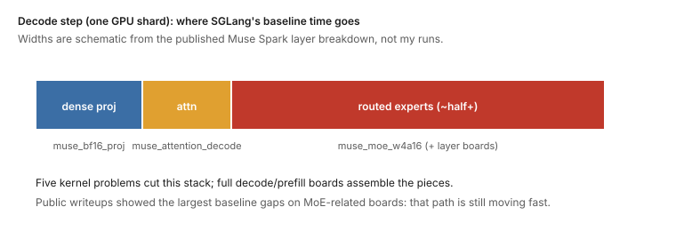
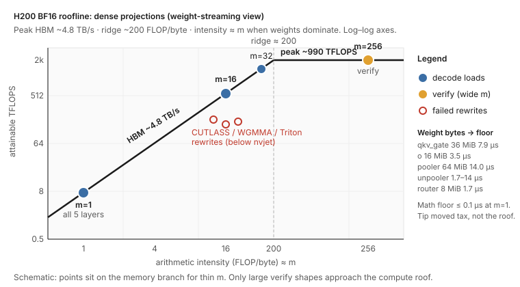
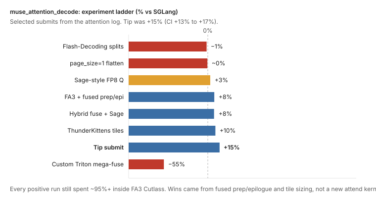
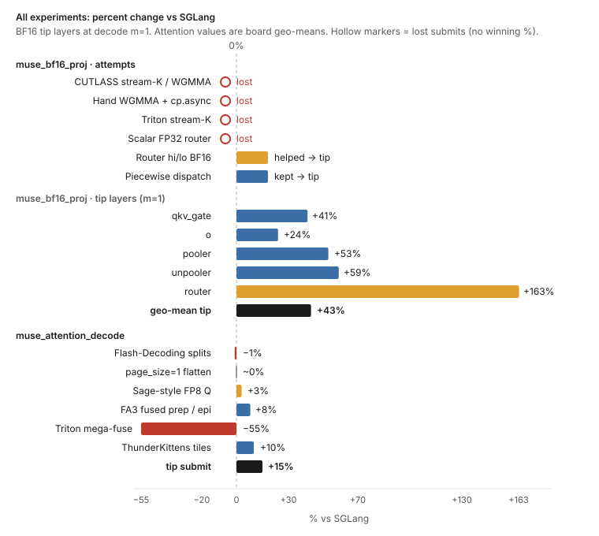

I used the [Open Kernel Challenge](https://openkernelchallenge.dev) as a bounded side project into **SGLang** on Muse Spark Open (816B MoE, ~42B active). Goal: see where a serving stack spends time on H200, and which edits matter (library GEMM, fused prep, or a custom kernel). Budget was a few remote judge runs a day. I did not expect large gains.

---

## Challenge Shape

The **kernel track** times five single-GPU cuts of one layer against SGLang on one **H200**. Score is a geo-mean over loads (0% = tie). One Python file, CUDA-graph capturable, readable GPU source built in-run; untimed `prepare()` may repack weights losslessly. The **serving track** (8×H200 SGLang patch) I barely touched.

| Board | Scope |
| :--- | :--- |
| `muse_bf16_proj` | Dense projections (qkv/gate, o, pooler, unpooler, router) |
| `muse_attention_decode` | Decode attention over FP8 paged KV |
| `muse_moe_w4a16` | Routed NVFP4 experts |
| `muse_decode_layer` | Full layer, decode / verify |
| `muse_prefill_layer` | Full layer, prefill |



Published Muse Spark prefill profiling puts **~65%** of time in routed experts. Public board reports also showed the largest gaps over SGLang on MoE-related problems (kernels still moving). Dense BF16 is older. Attention sits in between. Most of my time went to `muse_bf16_proj`.

---

## Dense BF16 Projections

**Idea.** Score `out = x @ W.T` for thin `m` (decode 1 / 16 / 32, verify up to 256) against large BF16 weights (`qkv_gate` ~36 MiB, `pooler` ~64 MiB; router FP32).

**What is timed.** Each call is one layer, one `m`, one `config`:

```python
class Inputs(TypedDict):
    x: torch.Tensor  # bfloat16 [m, k]
    config: Config


class Weights(TypedDict):
    qkv_gate: torch.Tensor  # bfloat16 [2304, 8192]
    o: torch.Tensor         # bfloat16 [8192, 1024]
    pooler: torch.Tensor    # bfloat16 [4096, 8192]
    unpooler: torch.Tensor  # bfloat16 [8192, 4096]
    router: torch.Tensor    # float32 [256, 8192]


class Config(TypedDict):
    m: int
    # output width; the unpooler's is 1024 up to 8 tokens (this GPU's
    # slice), else 8192
    n: int
    k: int
    # which weight: "qkv_gate", "o", "pooler", "unpooler" or "router"
    layer: str
```

| Layer | Weight [rows, k] | Bytes | Floor at 4.8 TB/s | Intensity at m |
| :--- | :--- | ---: | ---: | :--- |
| `qkv_gate` | [2304, 8192] bf16 | 36 MiB | 7.9 µs | ≈ m |
| `o` | [8192, 1024] bf16 | 16 MiB | 3.5 µs | ≈ m |
| `pooler` | [4096, 8192] bf16 | 64 MiB | 14.0 µs | ≈ m |
| `unpooler` | [8192, 4096] bf16 | 64 MiB (8 MiB when n = 1024) | 14.0 µs (1.7 µs for m ≤ 8) | ≈ m |
| `router` | [256, 8192] fp32 | 8 MiB | 1.7 µs | ≈ m / 2 |

Floor = `max(bytes / 4.8 TB/s, flops / 989 TFLOP/s)`. Intensity is FLOPs (`2·m·n·k`) over bytes moved, which is roughly `m` because the weight dominates the traffic. The router is FP32, so its weight costs twice the bytes per FLOP.

The judge's table ([`muse_bf16_proj/TASK.md`](https://github.com/0chonko/open-kernel-challenge-meta/blob/main/muse_bf16_proj/TASK.md)) maps loads to `m`: decode 1 / 16 / 32 uses `m` = 1 / 16 / 32, and verify 1 / 16 / 32 uses `m` = 8 / 128 / 256. Each layer runs **62** times per step. Unpooler at `m` ≤ 8 uses this GPU's `n = 1024` slice (1.7 µs floor); larger `m` reads the full 8192-wide weight.

**Scoring.** A load's time is the sum of its layers' times, each times its weight. Speedup is the geo-mean over loads, so each load counts equally. Timing replays CUDA graphs with a cold L2, against SGLang in paired runs. Correctness is relative L2 at most 1% against FP64, and 0.01% for the router. The router needs a BF16 hi + lo split with FP32 accumulation above 8 tokens. About one row in eight is a single power-of-two entry and must be within 0.1%.

**Why it matters.** At ~4.8 TB/s HBM, those weights alone are an **8 to 14 µs** memory floor. At `m=16`, qkv intensity is ~**16 FLOP/byte** vs a ridge near **200**. Decode loads are weight-streaming problems, not MMA puzzles.

### Memory floor

For each `(layer, m)`: bytes moved, mem floor, math floor. Pooler `m=1`: ~14 µs mem vs ~0.07 µs math. Qkv `m=16`: still ~8 µs mem-bound. Only the largest verify shapes approach compute-bound.



The roofline does not separate layers. All five sit on the same memory roof at their `m`; the weight bytes in the table above set each layer's floor.

When weights dominate, arithmetic intensity is roughly **m**. Decode sits on the HBM branch; custom GEMM rewrites (hollow red) never cleared the baseline that was already near the roof.

**Result.** Dropped ideas that could not beat the floor before they cost a submit.

### Baseline profiles

- **`m=1`:** SGLang Hopper GEMV, one launch, near the memory floor. Local headroom ~**6 to 15%** if you win cleanly. Custom scalar / weak WGMMA paths lost.
- **`m=16`:** cuBLAS **nvjet**. Qkv/pooler often = GEMM + **splitKreduce** (10 to 18% of time). `o` / `unpooler` often skip reduce → little headroom. No overlapping launches inside the timed graph; no precision drop under the rules.

**Result.** Headroom is cast/launch tax (router) or the reduce, not "rewrite nvjet."

### Iteration path


Board score is still `out = x @ W.T` for thin `m`. Attempts below tried different ways to implement that product.

### Rewrite the GEMM mainloop (lost)

Code: [`submission.py` @ f445cc7](https://github.com/0chonko/open-kernel-challenge-meta/blob/f445cc7/muse_bf16_proj/submission.py) (Stream-K), [`@ 53f3a0a`](https://github.com/0chonko/open-kernel-challenge-meta/blob/53f3a0a/muse_bf16_proj/submission.py) (WGMMA), [stream-K sketch](https://github.com/0chonko/open-kernel-challenge-meta/blob/main/papers/sketches/stream-k-work-centric-parallel-decomposition-for-dense/gemm_kernel.cu.pp).

CUTLASS sm90 stream-K / WGMMA, hand WGMMA + `cp.async`, Triton stream-K. Idea: if nvjet pays a split-K reduce, a better split might skip it:

```text
# stream-K sketch
for tile in split_K(W):
    Acc += x @ tile.T
out = reduce(Acc)
```

nvjet still won most `m>1` shapes. The job is streaming `W`, not inventing a better MMA.

### Scalar FP32 router (lost)

Code: [`submission.py` @ 3013eec](https://github.com/0chonko/open-kernel-challenge-meta/blob/3013eec/muse_bf16_proj/submission.py).

Router is the one small FP32 matmul. Try a plain kernel and skip cast round-trips:

```text
# W_r : FP32
out = gemv_fp32(x, W_r)    # one launch, no BF16 path
```

Router is tiny, so cast/launch tax could dominate, but this was still slower than the baseline path.

### Router hi/lo BF16, FP32 accumulate (helped)

Code: [`submission.py` @ d60f62b](https://github.com/0chonko/open-kernel-challenge-meta/blob/d60f62b/muse_bf16_proj/submission.py).

Split each FP32 weight into two BF16 halves, run BF16 GEMM, accumulate in FP32:

```text
W ≈ W_hi + scale * W_lo      # both BF16
out = (x @ W_hi.T) + scale * (x @ W_lo.T)   # FP32 acc
```

BF16 tensor-core throughput without dropping router precision. First clear router win.

### Piecewise dispatch (kept)

Code: [`submission.py` @ a132ea6](https://github.com/0chonko/open-kernel-challenge-meta/blob/a132ea6/muse_bf16_proj/submission.py) (assembled tip stack).

One kernel does not win every shape. Route by `(layer, m)` and only override where the profile shows tax:

```text
if layer == "router":        hi_lo_bf16(...)
elif m <= 1:                 hopper_gemv(...)
elif layer in (o, unpooler): cublasLt_pinned(...)   # already near floor
else:                        nvjet(...)             # qkv / pooler
```

### Tip (+43%)

Code: [`muse_bf16_proj/submission.py`](https://github.com/0chonko/open-kernel-challenge-meta/blob/main/muse_bf16_proj/submission.py).

Library path where it sits on the floor; custom work only on leftover tax (mostly **router**). Tip run scored **1.43×** (CI 1.40 to 1.45). At decode `m=1`, pooler is already near SOL (~14.0 µs yours vs 14.0 µs floor); router is still ~2.2× the floor after the hi/lo win, so launch and cast tax still matter there.


| Layer (decode m=1) | vs SGLang | Yours / floor |
| :--- | ---: | ---: |
| qkv_gate | +41% | 1.3× |
| o | +24% | 1.5× |
| pooler | +53% | 1.0× |
| unpooler | +59% | 2.4× (n = 1024 slice) |
| router | +163% | 2.2× |
| **Geo-mean (all loads)** | **+43%** (CI +40% to +45%) | |

**Next.** Treat BF16 rewrite as last resort when profiles already show one near-SOL GEMM; spend budget on MoE boards instead.

---

## Attention Decode

**Idea.** Younger stack (FA3, Flash-Decoding, Sage-style FP8 Q, paged KV). Fuse or retile around SGLang's attend instead of replacing it.

**Why it matters.** More baseline headroom than dense BF16, but FA3 still owns the timeline.

**What is timed.** One call is one GQA attention layer for one decode step or one 8-token verify block:

```python
class Inputs(TypedDict):
    qkv: torch.Tensor            # bfloat16 [B, L, (2*Hq + 2*Hkv)*64]
    positions: torch.Tensor      # int64 [B*L]
    cache_loc: torch.Tensor      # int64 [B*L], flat cache row per new token
    cache_seqlens: torch.Tensor  # int32 [B], seq_lens + L
    cu_seqlens_q: torch.Tensor   # int32 [B+1], 0, L, 2L, ...
    scheduler_metadata: torch.Tensor | None  # FA3 tile schedule, full-attention decode only
    k_cache: torch.Tensor        # float8_e4m3fn [pages, page_size, Hkv, 64], written in place
    v_cache: torch.Tensor        # float8_e4m3fn [pages, page_size, Hkv, 64], written in place
    k_scale: torch.Tensor        # float32 []
    v_scale: torch.Tensor        # float32 []
    page_table: torch.Tensor     # int32 [B, max_pages], -1 unused
    seq_lens: torch.Tensor       # int32 [B]
    config: Config


class Config(TypedDict):
    batch: int            # B
    q_len: int            # L: 1 for decode, 8 for a speculative verify block
    num_q_heads: int      # Hq: 16 per GPU under TP8
    num_kv_heads: int     # Hkv: 2
    head_dim: int         # 64
    page_size: int        # 1 in the scored cases, 64 in some tests
    window: int           # 2048 on sliding layers; 0 = full attention
    rope_theta: float     # 500000 on sliding layers; 0 = no RoPE
    qk_scale_factor: float
    sm_scale: float       # 1/8
    kv_scale: float       # 1 in the scored cases
```

Output is `bfloat16 [B, L, Hq·64]`. Scored loads are `decode {1, 16, 32}` and `verify {1, 16, 32}` (L = 8), each on a sliding layer (2,048-token window with RoPE) and a full layer (whole ~80K-token context, no RoPE). SGLang runs with speculative decoding off for decode and its default recipe for verify.

| Layer | Runs per step | Floor, B = 1 | B = 16 | B = 32 |
| :--- | ---: | ---: | ---: | ---: |
| sliding (2,048 window, RoPE) | 46 | 0.1 µs | 1.6 µs | 3.3 µs |
| full (~80K context, no RoPE) | 16 | 4.3 µs | 63.2 µs | 126.4 µs |

Floors are from the judge's table in [`muse_attention_decode/TASK.md`](https://github.com/0chonko/open-kernel-challenge-meta/blob/main/muse_attention_decode/TASK.md). Intensity on unique KV is about **16 FLOP/byte** (`4·Hq / (2·Hkv)`), well below the ridge near 200, so the board is memory-bound at SOL. Verify reuses the same KV across 8 queries in the floor bound, so its intensity is higher than decode, but measured traffic on large full shapes still lands around **3×** the unique-KV bytes (cold L2, page gather, head reuse shortfall, epilogue).

**Scoring and rules.** Same geo-mean over loads as the projections. Each load is one `(mode, B)` with **sliding × 46 + full × 16**, so sliding tax moves the score more than shaving another percent off a huge full FA. Correctness is relative L2 against an FP32 reference, within 2.5× the FP8-query reference error plus 1.5%, clamped to 3 to 15%. New cache entries must match within 8%. The 16 pre-timing tests include data-parallel heads, a 1M-token context, page size 64, and KV scales of 1/64. Every key must be attended: no top-k, sparse, or block-skipping attention. Queries may be rounded to FP8 E4M3, as FA3 does, but the KV cache stays FP8.

**Baseline launch chain** (what SGLang pays around FA3):

```text
FusedQKNorm → store_cache → q.to(fp8) → [prepare_varlen?] → FA3 → [Combine?] → rms_norm_gate
```

Constants on scored shapes: `Hq=16`, `Hkv=2`, `D=64`, GQA=8, `page_size=1`, `kv_scale=1`, `sm_scale=1/8`, `qk_scale_factor=5.473` (FA softmax scale `5.473/8`), RoPE θ=`5e5` on sliding only. Specs and floors: [meta repo](https://github.com/0chonko/open-kernel-challenge-meta).

### Iteration path


FA3 stays the attend kernel unless noted. The hunt was for tax *around* attend.

### Flash-Decoding `num_splits` (−1%)

Code: [`submission.py` @ ef3a9dc](https://github.com/0chonko/open-kernel-challenge-meta/blob/ef3a9dc/muse_attention_decode/submission.py).

Split the KV cache into `S` chunks, attend each chunk, then reduce partial outputs:

```text
for s in 0..S:
    O_s, m_s, l_s = attend(Q, K[s], V[s])
O = online_softmax_reduce(O_s, m_s, l_s)
```

Too small `S` underuses SMs; too large `S` pays for a fat reduce. Baseline was already near the sweet spot, so retuning lost a bit.

### `page_size=1` flatten (~0%)

Code: [`submission.py` @ bed4af3](https://github.com/0chonko/open-kernel-challenge-meta/blob/bed4af3/muse_attention_decode/submission.py).

Materialize paged KV into a contiguous block before FA3:

```text
# pages[table[i]] -> flat[i * page_size : (i+1) * page_size]
K_flat, V_flat = gather(K_pages, V_pages, page_table)
O = FA3(Q, K_flat, V_flat)
```

Tests whether page-table indirection was the tax. It wasn't on this board.

### Sage-style FP8 Q (+3%)

Code: [`submission.py` @ 9558aea](https://github.com/0chonko/open-kernel-challenge-meta/blob/9558aea/muse_attention_decode/submission.py).

Quantize only Q, keep the board's FP8 paged KV:

```text
Q8 = quantize_fp8(Q)
O  = FA3(Q8, K8_paged, V8_paged)
```

Fewer bytes on the Q side. Small gain; FA3 still owned the timeline.

### FA3 + fused prep / epilogue (+8%)

Code: [`submission.py` @ cdcd1a9](https://github.com/0chonko/open-kernel-challenge-meta/blob/cdcd1a9/muse_attention_decode/submission.py).

Collapse the launches around attend into one prep and one epilogue:

```text
# was: rmsnorm(Q) → rope(Q) → cast_fp8(Q) → FA3 → rmsnorm(O) * gate
Q8 = fuse_rmsnorm_rope_fp8(Q, W_q)
O  = FA3(Q8, K_paged, V_paged)
Y  = fuse_rmsnorm_gate(O, gate)
```

Those edge kernels are real wall time even when FA3 is ~95% of the GPU. First clear win without touching the mainloop.

### Custom Triton sliding mega-fuse (−55%)

Code: [`submission.py` @ 60f6ec6](https://github.com/0chonko/open-kernel-challenge-meta/blob/60f6ec6/muse_attention_decode/submission.py).

Replace FA3 with one Triton kernel over the sliding window:

```text
O = triton_sliding_attn(Q, K, V, window)   # no FA3
```

If fusing the edges helps, maybe fusing everything helps more. Dead end: a new attend kernel lost badly to FA3's Cutlass mainloop.

### ThunderKittens tiles on the fuse tip (+10%)

Code: [`submission.py` @ 024b796](https://github.com/0chonko/open-kernel-challenge-meta/blob/024b796/muse_attention_decode/submission.py), [TK sketch](https://github.com/0chonko/open-kernel-challenge-meta/blob/main/papers/sketches/thunderkittens-simple-fast-and-adorable-ai-kernels/gemm_kernel.cu.pp).

Keep the fused prep/epilogue; only change tile shapes fed to the FA3-adjacent path:

```text
# example knobs
BLOCK_M, BLOCK_N, BLOCK_K = 64, 64, 64   # retuned
```

Once fusion is in, tile size is the remaining free variable.

### Tip (+15%)

Code: [`submission.py` @ 2d001cc](https://github.com/0chonko/open-kernel-challenge-meta/blob/2d001cc/muse_attention_decode/submission.py) (FA3 fuse tip; `main` later moved to a full gated CUDA path).

Best stack: FA3 kept, fused prep/epilogue, tuned tiles. Tip run scored **1.10×** on an intermediate fuse spine (CI 1.08 to 1.12); later tile retunes pushed the published tip to about **+15%** (CI +13% to +17%). Tip launch chain:

```text
_fused_qk_rope_store → [prepare_varlen?] → FA3 → [Combine?] → [ATen?] → _rms_norm_gate_epilogue
```

| Regime | FA main share | Side tax | Yours / SOL | What limits |
| :--- | ---: | ---: | ---: | :--- |
| Sliding (all B) | ~45 to 60% | prep, combine, epi, ATen | 8 to 190× | launch / fixed cost on a short kernel |
| Full B=1 | ~55 to 60% | combine heavy | ~6 to 7× | splits + combine |
| Full B=16/32 | ~93 to 98% | tiny | ~3× | KV HBM + page gather |

Speedup is collapsing prep/epi and small FA layout wins, not beating FA's HBM by 3×. Full large-B stays within a couple percent of SGLang. Hitting SOL on sliding alone would move the geo-mean more than another percent off huge full FA.



**Next.** Keep FA3; wire the fused prep/epilogue into the full decode-layer board.

---

## Scoreboard

Same axis for every attempt I logged. Hollow markers are BF16 rewrites that never beat SGLang (no published %), so they are not drawn as fake bars.



---

## Patching Strike Points

1. Roofline the shape first. If bytes / peak BW match baseline wall time, stop.
2. If one Cutlass/nvjet kernel owns ~95% of time, fuse prep/epilogue or fix dispatch; do not rewrite the mainloop first.
3. Enforce CUDA-graph constraints before timing (no host sync, no value-dependent allocs, no illegal overlap).
4. MoE / NVFP4 left the most room over SGLang in public reports; that board is the better second pass.

**Next with more budget:** `muse_moe_w4a16` (`prepare()` layouts, swap-AB for small token counts), then fold attention fusions into `muse_decode_layer`.

---

## Takeaways

1. Thin-M BF16 proj on H200 is mostly streaming `W`.
2. Best submits kept nvjet/FA3 and removed tax around them (+43% proj tip, +15% attn tip).
3. MoE boards had more leeway because those kernels are still young.
4. A few H200 shots are enough to map where SGLang is worth patching.

---

### References

Challenge and code:

* Paradigm / Meta / Andromeda, [Muse Spark Open Kernel Challenge](https://openkernelchallenge.dev); [announcement](https://www.paradigm.xyz/writing/muse-spark-open-kernel-challenge).
* Meta repo notes: [`papers/`](https://github.com/0chonko/open-kernel-challenge-meta/tree/main/papers) ([`index.txt`](https://github.com/0chonko/open-kernel-challenge-meta/blob/main/papers/index.txt), [`extractions/`](https://github.com/0chonko/open-kernel-challenge-meta/tree/main/papers/extractions), [`sketches/`](https://github.com/0chonko/open-kernel-challenge-meta/tree/main/papers/sketches)).
* SGLang baselines: [`muse_bf16_proj/baseline.py`](https://github.com/0chonko/open-kernel-challenge-meta/blob/main/muse_bf16_proj/baseline.py), [`muse_attention_decode/baseline.py`](https://github.com/0chonko/open-kernel-challenge-meta/blob/main/muse_attention_decode/baseline.py).
* Tip submits: [`muse_bf16_proj/submission.py`](https://github.com/0chonko/open-kernel-challenge-meta/blob/main/muse_bf16_proj/submission.py); attention FA3-fuse tip [`@ 2d001cc`](https://github.com/0chonko/open-kernel-challenge-meta/blob/2d001cc/muse_attention_decode/submission.py).

Papers used for these two boards (tracked under [`papers/`](https://github.com/0chonko/open-kernel-challenge-meta/tree/main/papers)):

* [*FlashAttention-3*](https://arxiv.org/abs/2407.08608) (2024); [*FlashAttention-2*](https://arxiv.org/abs/2307.08691) (2024); [*FlashAttention-4*](https://arxiv.org/abs/2603.05451) (2026).
* *Flash-Decoding* (Hong / Dao, 2023).
* [*SageAttention3*](https://arxiv.org/abs/2505.11594) (2025).
* [*PagedAttention*](https://arxiv.org/abs/2309.06180) (SOSP 2023).
* [*ThunderKittens*](https://arxiv.org/abs/2410.20399) (ICLR 2025); [local sketch](https://github.com/0chonko/open-kernel-challenge-meta/tree/main/papers/sketches/thunderkittens-simple-fast-and-adorable-ai-kernels).
* [*Stream-K*](https://arxiv.org/abs/2301.03598) (PPoPP 2023); [local sketch](https://github.com/0chonko/open-kernel-challenge-meta/tree/main/papers/sketches/stream-k-work-centric-parallel-decomposition-for-dense).
* [*FlashInfer*](https://arxiv.org/abs/2501.01005) (MLSys 2025).
* [*QServe*](https://arxiv.org/abs/2405.04532) (MLSys 2025).
* [*Ladder*](https://arxiv.org/abs/2312.10688) (OSDI 2024).
* [*POD-Attention*](https://arxiv.org/abs/2410.18038) (ASPLOS 2025).
* [*Flex Attention*](https://arxiv.org/abs/2412.05496) (2024).
* [*Tilus*](https://arxiv.org/abs/2504.12984) (ASPLOS 2026); TileLang (ICLR 2026); PipeThreader (OSDI 2025).
