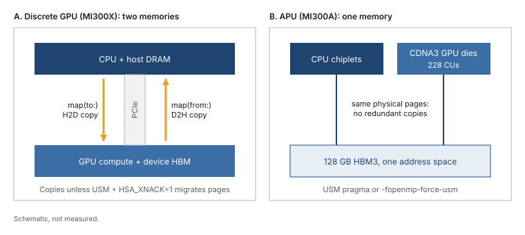

Most of my GPU work has been CUDA: kernels, NVLink bandwidth, power profiling on A100 and H100 nodes. CPU OpenMP I know from cache-line tuning in a SystemC simulator and from MPI+OpenMP hybrid jobs on Snellius. **OpenMP target offload** on AMD was a gap, and it kept coming up next to portability and Fortran weather codes.

So I spent two days in an online **HLRS** tutorial on **OpenMP offloading with AMD GPUs**, doing exercises on the **AMD Accelerator Cloud (AAC)** against **MI300A** APUs. The course went from "add a `#pragma omp target` and hope" to knowing when unified shared memory really removes copies, when discrete GPUs need explicit `map` clauses, and why you read `LIBOMPTARGET_KERNEL_TRACE` before opening `rocprofv3`. These are my condensed notes, plus how they connect to my MPI and profiling work.

---

## Why Another GPU Programming Model?

CUDA and HIP give fine control. OpenMP offers a **standard directive-based model** that composes with host threading and ports across vendors. On AMD the stack is **ROCm + LLVM-based `amdclang`/`amdflang`**, with offload built into the same compiler you use for host OpenMP.

The tutorial framed the choice as economics, not ideology:

* **APUs (MI300A)** share one physical memory pool between CPU and GPU. Porting a CPU loop can be almost mechanical if you accept unified shared memory semantics.
* **Discrete GPUs (MI300X and friends)** still need explicit data environments. The directives look the same; the runtime behavior does not.
* **Fortran production codes** (weather, climate, chemistry) are already OpenMP-heavy on the host. Offload is much less work than rewriting hot loops in HIP.

That last point landed when Johanna Potyka walked through **CLOUDSC** and other ECMWF-style mini-apps. The question is not "can OpenMP express this kernel?" but "how far does `target teams distribute parallel do collapse(...)` get you before compiler quirks and data movement bite?"

---

## Hardware: MI300A Is an APU, Not a Bolt-On GPU

An **APU** is not a GPU glued to a CPU socket. On MI300A, CPU chiplets and CDNA3 compute dies share **128 GB HBM3** in one address space. There is no separate host DRAM and device HBM to shuttle data between over PCIe.



For porting, that matters right away:

| Mode | Typical hardware | Data movement | What you add in source |
| :--- | :--- | :--- | :--- |
| Discrete (default) | MI300X, MI250 | Explicit H2D/D2H copies via `map` | `map(to:...)` / `map(from:...)` |
| USM on discrete | MI300X + page migration | Zero-copy via XNACK | `#pragma omp requires unified_shared_memory` + `HSA_XNACK=1` |
| APU zero-copy | MI300A | No redundant copies in the common case | USM pragma or `-fopenmp-force-usm` |

Exercises ran on **aac6** (open ROCm 6.4.1) and **aac7** (HPE Cray Programming Environment on production MI300A). With 50+ participants, SLURM etiquette was part of the lesson: `salloc --gpus=1` with `--mem` capped below a full node, so four people could share a machine.

---

## Day 1: Unified Shared Memory and the First Surprise

### USM: the same pointer everywhere

**Unified Shared Memory (USM)** is an OpenMP contract, not just a ROCm feature. Declare it once per translation unit:

```cpp
#pragma omp requires unified_shared_memory
```

On AMD you also need **XNACK** at compile time (`--offload-arch=gfx942`) and at runtime:

```bash
export HSA_XNACK=1
```

With USM, `map` clauses become optional. Host pointers used in `target` regions trigger **page migration** on discrete hardware, or direct access on MI300A with no copies.

Michael Klemm's mental model: without USM, you wrap compute in a data environment that uploads at the opening brace and downloads at the closing one. With USM you can often write:

```cpp
#pragma omp requires unified_shared_memory

double *in  = (double*)malloc(M * sizeof(double));
double *out = (double*)malloc(M * sizeof(double));

// host initialization writes visible to the device after migration
for (int i = 0; i < M; i++) in[i] = ...;

#pragma omp target teams distribute parallel for
for (int i = 0; i < M; i++)
  out[i] = f(in[i]);

// host reads out[] without an explicit map(from:)
```

That is the fastest way to port CPU OpenMP loops. It is not free: migration has a cost, and mixing USM with `map` on the same buffers switches access semantics to coarse grain.

### Offload is not parallelism (my first broken saxpy)

First debugging cliff. A lone `#pragma omp target` moves execution to the device **sequentially and synchronously**. It does not create a parallel team. You still need `teams distribute parallel for` (or the Fortran `do` form).

My first Fortran saxpy "worked" (checksum matched), but `LIBOMPTARGET_KERNEL_TRACE=1` showed **1 team x 256 threads** and terrible occupancy. It ran on the GPU without using it.

MI300A has **228 CUs** with **64-wide wavefronts**. A flat `parallel for` will not fill that the way CPU threading intuition suggests. You need multi-level parallelism:

```cpp
#pragma omp target teams distribute parallel for
for (int i = 0; i < n; i++)
  y[i] = a * x[i] + y[i];
```

`teams` maps to workgroups, `distribute` splits the iterations across them, and `parallel for` fills each CU with wavefronts. AMD's compilers ignore host `simd` on device code anyway; the hierarchy is the whole story.

### Discrete memory: without USM, maps are the contract

The second block switched to **discrete-GPU semantics** on the same AAC hardware, by setting `HSA_XNACK=0` and using explicit maps.

A minimal saxpy with `LIBOMPTARGET_KERNEL_TRACE=2`, run twice, said more than the slides:

```text
Call data_submit_async: 450us  ... 4194304 bytes
Call launch_kernel:       43us
Call data_retrieve_async: 204us ... 4194304 bytes
Call data_delete:         99us
```

Four megabytes each way, twice, for two back-to-back target calls. The kernel took **43 microseconds**. That is the discrete-GPU trap in one log: a "successful offload" can spend far more time moving data than computing.

The fix is not a fancier pragma on one call. It is **persistent data environments**:

```cpp
#pragma omp target data map(to: a[:N], b[:N]) map(tofrom: c[:N])
{
  compute_kernel_1(...);  // nested targets find data via presence checks
  saxpy(...);
  compute_kernel_2(...);
}
```

Or the unscoped form for longer-lived state:

```fortran
!$omp target enter data map(to: input(1:N)) map(alloc: tmp(1:N))
! ... multiple target regions ...
!$omp target exit data map(from: res) map(delete: tmp)
```

`target update` pushes host-side changes into an existing device environment without tearing down the map. That is what separates a demo from something that survives a time-step loop.

---

## Day 2: Real Codes, Real Pitfalls

### Fortran defaults will race on you

The application session opened with a trap I would have walked into:

```fortran
real(kind=rt) :: tmp = 0.0_rt   ! initialized declaration
real(kind=rt) :: a(10000)
!$omp target teams distribute parallel do
do i = 1, 10000
  tmp = real(i, kind=rt)
  a(i) = tmp
end do
```

The output changes every run. In Fortran an initialized local is a **SAVE** variable, which OpenMP treats as **shared**, so every iteration races on `tmp`. Drop the initialization (making `tmp` a true local) or use `default(none)` with `private(tmp)`.

The advice was blunt: on device code use **`default(none)`** unless you have a reason not to. Same spirit as verifying the UCX transport on Snellius: assumptions that hold for CPU OpenMP break silently on the GPU.

### SPMD mode: do not split your pragmas

**`target teams distribute parallel for` on one line** (Fortran: continue with `&`) encourages **SPMD** code generation. Splitting it:

```fortran
!$omp target
!$omp teams distribute parallel do
```

can lead to different outlining and optimization depending on the compiler. Not always wrong, but the course treated needless splitting as a portability smell.

### Weather mini-apps: collapse has limits

CLOUDSC and similar kernels stress **column-parallel weather physics**: many independent columns, deep loop nests, Fortran array syntax. The question is how far `collapse` can fuse loops before register pressure and cache behavior on CDNA3 push back.

From the examples:

* Port **compute-heavy loops** first; leave `workshare` and array-syntax assignments for later.
* OpenMP 6.0 adds `workdistribute` for whole-array operations, but **no compiler in the room implemented it yet**. Workaround: `distribute parallel do` over indices.
* **`allocate` inside a target loop** is fragile (broken on CCE 18 in one example; works with `amdflang` and `-lflang_rt.hostdevice`, but slowly). Hoist allocations out of the kernel.

### Jacobi and OpenFOAM-style porting

The Jacobi solvers and CFD mini-apps (OpenFOAM-related examples in the materials) followed the same loop: get correctness with USM on the APU, then turn off XNACK and add data environments for discrete-GPU performance, then profile before tuning launch parameters.

---

## Profiling: Start Cheap, Then Open the ROCm Toolbox

Luka Stanisic's profiling block matched how I work on Snellius: **free introspection first**, heavy tools only once you know the question.

### Layer 0: libomptarget runtime output

Before `rocprofv3`:

```bash
export LIBOMPTARGET_KERNEL_TRACE=1   # kernel names, teams, threads, registers
export LIBOMPTARGET_KERNEL_TRACE=2   # adds timing for kernels and data transfers
export LIBOMPTARGET_INFO=$((0x20 | 0x02 | 0x01 | 0x10))  # verbose data movement
```

For the saxpy exercise, level 2 was enough to show the bottleneck was `data_submit_async`, not the kernel launch.

### Layer 1: rocprofv3 for timelines and hotspots

AMD's current tracing CLI, built on **rocprofiler-sdk**:

```bash
rocprofv3 --kernel-trace --stats --summary -- ./my_openmp_app
rocprofv3 --sys-trace --output-format pftrace -- ./my_openmp_app
```

`--kernel-trace` (or `--sys-trace`) captures GPU dispatches from target regions. It does **not** profile host-side OpenMP parallel regions, a gap to remember for hybrid host/device code.

Open the `.pftrace` in [Perfetto](https://ui.perfetto.dev/) to line up H2D copies, kernels, and HSA activity on one timeline. The exercise lives in `HPCTrainingExamples/Rocprofv3/OpenMP/`.

### Layer 2: rocprof-compute for one kernel

Once you know *which* `__omp_offloading_*` kernel hurts, **rocprof-compute** (formerly Omniperf) replays the app to collect hardware counters and roofline data:

```bash
rocprof-compute profile -n my_kernel -- ./my_openmp_app
rocprof-compute analyze -p workloads/my_kernel/<gpu_arch>/
```

OpenMP outlining can hide source names; the tool keys off **dispatch IDs** and launch geometry, which still show whether you launched one team or hundreds.

### Layer 3: rocprof-sys for the whole program

**rocprof-sys** (formerly Omnitrace) puts host threads, GPU activity, and eventually MPI in one trace. Overkill for saxpy; useful when offload sits inside a multi-rank job.

| Tool | Best for | OpenMP offload caveat |
| :--- | :--- | :--- |
| `LIBOMPTARGET_*` env vars | Quick copy vs kernel sanity check | Text only, but zero setup |
| `rocprofv3` | Timelines, hotspots, CSV counters | GPU side of offload; not host `parallel` |
| `rocprof-compute` | Per-kernel roofline and stalls | Multiple replays; kernel names may be mangled |
| `rocprof-sys` | End-to-end application trace | Heavier; OMPT offload support evolving |

---

## What This Connects To (and What I Have Not Tried)

The course sits next to several threads of my own work:

* **CUDA energy profiling** taught me to separate measurement overhead from the effect. `LIBOMPTARGET_KERNEL_TRACE=2` is the same instinct: read the transfer lines before tuning tile sizes.
* **UCX/MPI on Snellius** was about proving the runtime took the fast path. Offload has the same issue: USM with `HSA_XNACK=1` and explicit maps with `HSA_XNACK=0` are different machines, and mixing them without noticing is the silent fallback.
* **SystemC OpenMP cache tuning** was host-only, but the Fortran `SAVE` pitfall is the same class of bug: CPU language semantics do not disappear on the GPU.
* **GASPI/HPC communication** is further up the stack, but the Jacobi and ghost-exchange examples in the HLRS materials hint at where GPU-aware MPI and offload meet.

What I have not checked myself: whether a production weather kernel ported with USM on MI300A, then tightened with `target data` for MI300X, beats a hand-tuned HIP port on the same case. I also have not run `rocprofv3` on an OpenMP+MPI job at scale. Those are the natural next steps, not another pass through the slides.

---

## Practical Takeaways

1. **`target` and `parallel` are separate decisions.** Offload moves execution; `teams distribute parallel for` creates GPU parallelism. A correct checksum with 1x256 threads is a failed port.
2. **Pick the memory model on purpose.** USM plus `HSA_XNACK=1` for fast CPU-to-GPU porting on APUs; explicit `target data` / `enter data` when XNACK is off or copies must be minimal.
3. **Read `LIBOMPTARGET_KERNEL_TRACE=2` before rocprof.** If `data_submit_async` dominates `launch_kernel`, fix data persistence before touching tile sizes.
4. **Use `default(none)` on device loops.** Initialized Fortran locals are `SAVE`, so shared, so they race.
5. **Keep `target teams distribute` fused.** SPMD outlining is compiler-sensitive; do not split pragmas without a measured reason.
6. **Profile GPU dispatches with `rocprofv3 --kernel-trace`.** Host OpenMP and device offload are different subsystems; the tool only sees one.
7. **Check your architecture flag.** `--offload-arch=gfx942` for MI300A on AAC; MI300X uses the same ISA but behaves differently at runtime because of memory.

---

### References

* HLRS / AMD, *Introduction to OpenMP Offloading with AMD GPUs* (2-day online course, Oct 21 to 22, 2025). [Course materials](https://fs.hlrs.de/projects/par/events/2025/GPU-OPENMP-AMD/). [Certificate](/assets/blog/openmp-offload-hlrs-tutorial/personal-certificate.pdf).
* AMD, [HPCTrainingExamples](https://github.com/AMD/HPCTrainingExamples) (OpenMP C/Fortran exercises, Rocprofv3 OpenMP labs).
* AMD ROCm, [OpenMP support and USM](https://rocm.docs.amd.com/projects/llvm-project/en/latest/conceptual/openmp.html).
* AMD ROCm, [Using rocprofv3 with OpenMP](https://rocm.docs.amd.com/projects/rocprofiler-sdk/en/latest/how-to/using-rocprofv3-with-openmp.html).
* Full list: [All references](/readinglist/).

---
