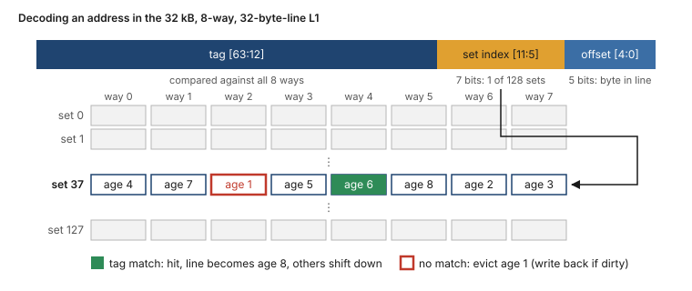
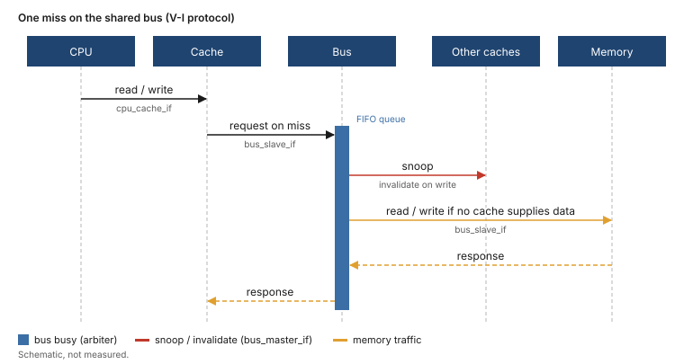
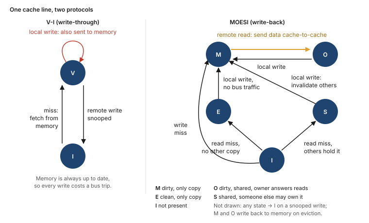
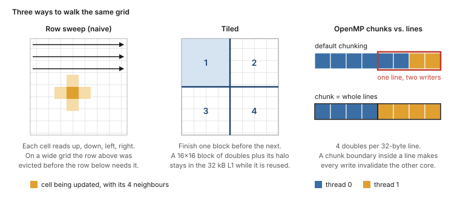

Writing fast software means understanding the memory hierarchy well enough that surprises feel explainable, not magical. I built a trace-driven cache simulator in SystemC to poke at that directly.

The simulator grew in four steps: single-core L1, shared-bus multicore, a MOESI upgrade, and finally an OpenMP heat-diffusion kernel to see how software choices show up in cache-line states and bus traffic.

---

## 1. A Single-Core L1 Data Cache

I started with an L1 data cache. Instead of adding a new module between the existing CPU and Memory components, I put the cache logic inside the Memory module. It tries the cache first and only falls back to simulated DRAM when needed, which keeps the transaction boundary clean.

### Structure and Address Decoding
The C++ structures mirror the hardware layout:

```cpp
struct CacheLine {
    uint64_t tag;
    uint32_t data[8]; // 32 bytes (8 words)
    bool valid;
    bool dirty;
};

struct CacheSet {
    CacheLine lines[8]; // 8-way associativity
    uint8_t agingBits[8]; // Track LRU state
};
```

For the baseline **32 kB cache** with **32-byte lines** and **8-way associativity**:
*   1024 cache lines in total.
*   8 ways give 128 sets.
*   Addresses are decoded at runtime: the 5 lowest bits are the byte offset, the next 7 the set index, the rest the tag. Because it is parameterized, 64-byte lines or other capacities are easy.



The index decides *where* a line may live, and the tag decides *which* line it is. Two addresses that share index bits compete for the same 8 slots even if the rest of the cache is empty, which is where conflict misses come from.

### Policies: Write-Back, Write-Allocate, LRU
To save off-chip bandwidth I used **write-back** with **write-on-allocate**:
*   **Write-back:** modified lines go to memory only on eviction, so frequent writes do not generate memory traffic.
*   **Write-on-allocate:** on a write miss, the whole 32-byte block is fetched before the write. Standard practice, but it means tracking the `dirty` bit carefully.
*   **LRU eviction:** an aging array per set ranks valid lines from 1 (oldest, evicted first) to 8 (most recent). On a hit or allocation the line gets the max age and the others are decremented.

### Baseline Results
Traces: matrix multiplication (`max_mul` with several grid shapes) and Fast Fourier Transforms (`fft`).

| Cache Size | Workload | Hit Rate (%) |
|------------|----------|--------------|
| 32 KB | 50×50 | 96.42 |
| 32 KB | 200×200 | 97.76 |
| 32 KB | 5000×8 | 97.82 |
| 32 KB | 8×5000 | 96.77 |
| 32 KB | FFT | 97.91 |
| 128 KB | 8×5000 | 88.86 |
| 512 KB | 8×5000 | 97.73 |

Bigger caches mostly help, but not always. At 128 KB the 8×5000 workload dropped to 88.86%, then recovered to 97.73% at 512 KB. Some matrix shapes interact badly with the set indexing and cause conflict misses until the cache is big enough to hold the working set.

---

## 2. Multicore: Bus-Based Coherence (V-I Protocol)

More cores bring the classic cache coherence problem. Using SystemC Transaction-Level Modeling (TLM) ideas, I built a shared bus where master caches and memory-mapped slaves talk through well-defined interfaces.



### Interfaces
Three interfaces:
1.  `cpu_cache_if`: reads and writes issued by the CPU cores.
2.  `bus_slave_if`: implemented by main memory and the bus to handle forwarded transactions.
3.  `bus_master_if`: implemented by the bus and caches for arbitration and snooping.

### How the Bus Works
*   **Queueing:** the bus arbitrates simultaneous misses through a FIFO input queue.
*   **Snooping:** on a write miss the bus broadcasts a snoop to all other caches. In this simple write-through Valid-Invalid (V-I) model, matching lines in remote caches are invalidated immediately.
*   **Response path:** if no cache can supply the data, the bus forwards the request to main memory and passes the response back to the requesting cache.

### V-I Results
Average bus access latency (time from entering the queue to execution) stayed flat at around 100 simulation units across core counts, except for the 50×50 and 8×5000 workloads.

Write-through has a hard limit, though: every write goes to main memory, so the shared bus quickly becomes the bottleneck under realistic multicore load.

---

## 3. Upgrading to MOESI

To remove the write-through bottleneck and cut DRAM bandwidth, I moved to **MOESI (Modified, Owned, Exclusive, Shared, Invalid)**: a fuller state machine plus cache-to-cache transfers.

### States and Bus Transactions
With MOESI, caches can share dirty data without writing it back first:
*   **Owned (O) & Modified (M):** dirty data. If another core reads a `Modified` line, the owner moves it to `Owned` and sends the data directly to the requester (which stores it as `Shared`), skipping a slow DRAM read.
*   **Exclusive (E):** clean data held by one cache only, so a local write can move it to `Modified` without a bus invalidation.



The way I ended up reading the five states is as answers to three questions a cache asks about a line before it acts:

*   **Is memory stale?** `M` and `O` say yes, so someone has to write the line back on eviction. `E` and `S` say memory is fine (as far as this cache is concerned).
*   **Am I the only copy?** `M` and `E` say yes, so a local write needs no bus traffic at all. That is the `E → M` edge, and it is the cheapest write in the protocol.
*   **Who answers a remote read?** The `O` owner does, cache-to-cache, instead of forcing a write-back to DRAM followed by a DRAM read.

V-I is what you get when you refuse to answer any of these. Memory is never stale because every write goes through, nobody is ever the only copy, and nobody supplies data. That's simple, but it puts every store on the bus. MOESI keeps more state per line so that most writes and many reads never leave the core.

The bus request interface now carries state information:
```cpp
void request(uint64_t addr, bool isWrite, int coreId, bool isBusWriteback);
```
When an evicted line is `Modified` or `Owned`, the cache issues an `isBusWriteback` transaction to write it back to memory.

### V-I vs. MOESI

MOESI improved the metrics across the benchmarks.

#### Hit rates and scaling
With V-I, adding cores sharply lowered hit rates because of aggressive invalidation. MOESI kept hit rates high and stable (consistently above 80%) because cores could share read-only data in the `Shared` and `Owned` states.

#### Memory traffic
The main win is far fewer main-memory accesses. Since caches serve each other directly, DRAM reads dropped sharply, while write-backs stayed under control.

#### Bus contention
You might expect the more complex MOESI state machine to add bus contention. Instead, average bus acquisition time improved slightly: with far fewer slow DRAM accesses, the bus spent less time stalled on memory and the queues moved faster.

---

## 4. Software Side: Tuning OpenMP Heat Diffusion

With the multicore simulator working, I turned to software. I wrote a 2D heat diffusion code with **OpenMP** and looked at how parallelization and access patterns change the microarchitectural metrics.

Each grid cell is updated from its neighbors:

NewVal = f(Left, Right, Up, Down)



The variants below differ only in the order cells are visited and in which thread owns which cells. The arithmetic is identical. What changes is how long a line stays useful in L1 (left and middle) and whether two cores ever write the same line (right).

I ran five variants on the same grid, same problem size, and the same **32 kB** simulated L1.

1. **Naive:** redundant locals, cell-by-cell writes, no thought for how rows walk through a 32-byte line. This is the baseline for **time** and **bus-facing cache traffic**, not a cartoon of bad code. The simulator sees every load and store as a coherence event, so messy access shows up as more requests and invalidations even when the math is right.
2. **Improved array access:** pointer arithmetic instead of heavy local copies, fewer redundant stores, sequential reads along a row. Modest gain, but a full-row sweep still overflows the **32 kB** L1 before the next time step reuses those lines.
3. **Loop tiling 16×16:** traverse in **16×16** blocks so the active neighborhood stays in L1. This is the step that pays: total cache requests fell by nearly half, easing pressure on the shared bus. Hit rate dips slightly on entering a fresh block (cold misses), but wall time followed the request count, not the hit rate.
4. **Tiling 8×8:** smaller tiles gave diminishing returns. Once a tile already fits in L1, shrinking it mostly adds loop overhead and fragments spatial reuse.
5. **Cache-aligned OpenMP scheduling:** two threads writing adjacent doubles on the same 32-byte line false-share and bounce the line with invalidations. Matching the static chunk size to the simulated line gives each chunk whole lines:

```cpp
const int cacheLineSize = 32; // 32 bytes
const int doublesPerCacheLine = cacheLineSize / sizeof(double); // 4 doubles
const int chunk_size = ((M + doublesPerCacheLine - 1) / doublesPerCacheLine) * doublesPerCacheLine;

#pragma omp parallel for schedule(static, chunk_size)
```

| Variant | What we saw |
|---------|-------------|
| Naive | baseline time and cache traffic |
| Improved array access | cleaner sequential traffic; modest gain |
| Tile 16×16 | **time down**; **cache requests ~½** (hit rate dips slightly on cold block entry) |
| Tile 8×8 | diminishing returns: loop overhead and spatial fragmentation |
| Cache-aligned OpenMP | modest cut in invalidations vs default scheduling |

The aligned schedule is a small coherence win on top of tiling, not another big drop in time. It did not replace the 16×16 blocking step.

---

## Takeaways and Next Steps

Main lesson: **performance is a property of the hardware-software interaction, not of either one alone.**

Next steps if I take the simulator further:
1.  **Split-transaction bus and pipelining:** the bus currently blocks during memory accesses. A split-transaction bus would let other cores resolve cache-to-cache hits while a DRAM fetch is outstanding.
2.  **Better replacement policies:** tree-based pseudo-LRU or Hawkeye, to see how modern eviction handles large HPC datasets.
3.  **False-sharing counters:** dedicated simulator counters for "invalidation on write to a shared line" events, so false sharing can be found automatically.

The project gave me a solid feel for cycle-approximate modeling, and in hindsight it fed the cache-line and false-sharing instincts I needed later when profiling GPU collectives on Snellius.
