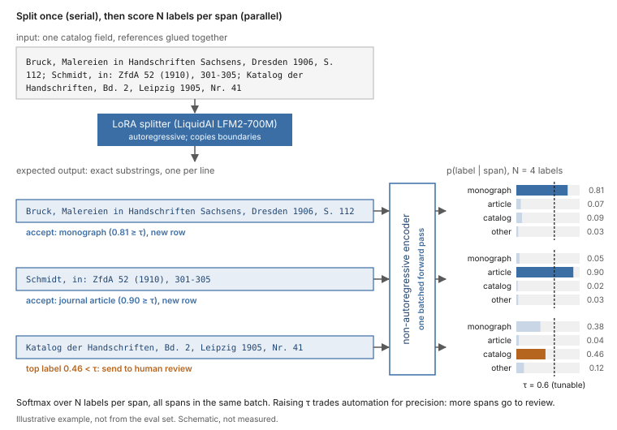
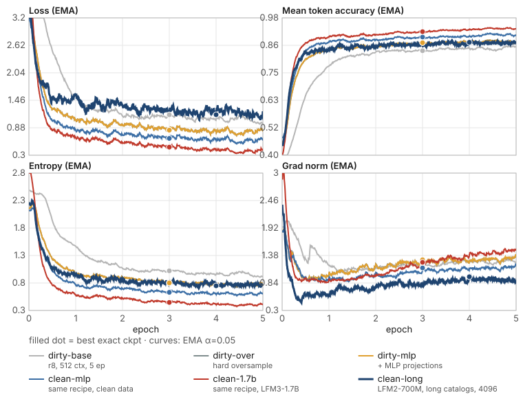

This is the second post in the series that started with [From Manuscript Transcriptions to JSON](/blog/From-Manuscript-Transcriptions-to-JSON-A-Configurable-Extraction-Pipeline/). That opening post is about the whole migration: noisy university-library transcriptions into schema-valid JSON for a new metadata backend, with prefilling, grammar constraints, and LoRA only if prompting is not enough. This post is one field inside that same pipeline.

Some catalog records paste a run of literature references into a single string. The backend wants **one database row per reference**, so before (or beside) the full-record JSON extraction those glued citations have to be split into exact, in-order substrings of the input, one per line. No paraphrasing, no normalizing, no "helpful" cleanup. Out of the box, both LiquidAI models I tried ([`LFM2-700M`](https://huggingface.co/LiquidAI/LFM2-700M) and [`LFM3-1.7B`](https://huggingface.co/LiquidAI/LFM3-1.7B)) scored **0/93 exact**. They knew what a citation looks like, they just couldn't stop rewriting it. For this narrow sub-problem, a small LoRA adapter was the right step after all, and it runs on a consumer GPU.

---

## Why Split at All

Splitting is not the end goal. What I actually want is to make decisions about each reference: is it a monograph, a journal article, or an older catalog? Does it already exist in the backend, so the new row should link to it instead of duplicating it? A glued string can't answer any of that, because those questions only make sense for one reference at a time.



The point is that these decisions are **independent per reference**. Once the boundaries are known, nothing about classifying the second reference depends on the first. That turns the problem into something a **non-autoregressive** model can handle: an encoder (I'm leaning towards a JEV-like model, which predicts in embedding space instead of generating tokens) that maps every span to a vector and scores the labels in one forward pass. For each span it returns a probability over N labels, and a tunable threshold τ decides whether the top label is trusted or the span goes to a human. A catalog with 40 references becomes 40 rows of a single batch, not 40 rounds of token-by-token decoding. Across a whole library that is the part I care about: a massively parallel decision layer, where the expensive serial work happens once (finding the boundaries) and everything after it is a batch.

The alternative is asking one generative model to find the boundaries *and* label each reference while it decodes. That is serial by construction, and a single wrong boundary contaminates every label after it. Splitting first keeps the hard sequential part small and checkable: every output line must be an exact substring of the input, so a wrong split is easy to detect before anything downstream sees it.

There is a second angle I want to try later. An inference engine like vLLM sees a prompt as one flat stream of token IDs coming out of the tokenizer, before the model's embedding layer turns them into vectors. Tokenizers already do a crude version of this split in their **pre-tokenization** step (cutting on whitespace and punctuation before BPE runs), but they know nothing about where one citation ends and the next begins. The splitter is basically a learned pre-tokenizer at reference granularity. Patching the engine's input processing so requests arrive as already-segmented units, or passing per-span vectors in directly (vLLM accepts precomputed prompt embeddings), would give the model better-informed units to work with than raw subword tokens. I haven't built that part. This post is only about getting the boundaries right, because everything above depends on it.

---

## Setup

- **Models:** [`LiquidAI/LFM2-700M`](https://huggingface.co/LiquidAI/LFM2-700M) locally (LFM2 generation), [`LiquidAI/LFM3-1.7B`](https://huggingface.co/LiquidAI/LFM3-1.7B) on the cluster's L40 nodes (LFM3 generation).
- **Hardware:** RTX 3060 Ti (8 GB) at home, L40 (48 GB) on the HPC side. Code and data sync over Tailscale with a small `rsync` script that skips adapters and caches (about 6 GB down to 5 MB).
- **Training:** PEFT `LoraConfig` + TRL `SFTTrainer`, bf16, gradient checkpointing, batch 1 with gradient accumulation 8, learning rate 2e-4. Each example is a chat pair: catalog text in, newline-joined spans out.
- **Data:** about 840 hand-checked clean rows, an OCR-noisy "dirty" twin of the same rows, and 131 reconstructed long catalogs with many spans each.
- **Eval:** a fixed 93-row clean held-out set. **Exact** means the whole predicted list matches. I also track bag-of-spans F1, break results down by how many spans a row has, and score every epoch checkpoint, not just the last one.

Each experiment is one TOML config (datasets, oversample block, LoRA knobs). The names below are stable labels I use in prose, tables, and the checkpoint chart:

| Experiment | Model | Train data | Main change from previous |
| :--- | :--- | :--- | :--- |
| `zero-shot` | LFM2-700M | n/a | no adapter |
| `dirty-base` | LFM2-700M | dirty | r8, 512 tokens, 5 epochs |
| `dirty-ctx` | LFM2-700M | dirty | context 1536 |
| `dirty-r16` | LFM2-700M | dirty | rank 16 (α=32) |
| `dirty-over` | LFM2-700M | dirty | hard rows oversampled |
| `dirty-mlp` | LFM2-700M | dirty | also adapt MLP (`up`/`down`/`gate`) |
| `clean-mlp` | LFM2-700M | clean | same recipe as `dirty-mlp`, clean data |
| `clean-1.7b` | LFM3-1.7B | clean | same recipe, larger model |
| `clean-long` | LFM2-700M | clean + long catalogs | reconstructed long catalogs, 4096 context |

---

## The Ablation Ladder

The first block (`dirty-*`) changes one adapter knob at a time on OCR-noisy training data. Then `clean-mlp` swaps the train set, `clean-1.7b` scales the model, and `clean-long` changes the data shape. Every adapter was scored at every epoch checkpoint against the same clean gold:

| Experiment | Exact (final) | Exact (best, epoch) | 5-7 spans (final) |
| :--- | :--- | :--- | :--- |
| `zero-shot` | 0/93 | n/a | 0/32 |
| `dirty-base` | 64/93 | 66 (3) | 16/32 |
| `dirty-ctx` | 61/93 | 62 (2) | 15/32 |
| `dirty-r16` | 66/93 | 66 (3) | 17/32 |
| `dirty-over` | 66/93 | 73 (3) | 19/32 |
| `dirty-mlp` | 69/93 | 74 (3) | 20/32 |
| `clean-mlp` | 71/93 | 75 (3) | 20/32 |
| `clean-1.7b` | 81/93 | **84** (3) | 29/32 |
| `clean-long` | 82/93 | **83** (4) | 29/32 |

On LFM2-700M, the knobs (context, rank, oversampling, target modules) together moved the final score from 64 to 69. Switching from dirty to clean training data (`dirty-mlp` → `clean-mlp`) added only 2 more. Both changes are real, but neither is dramatic, and on 93 rows a single example is about 1.1 points.

The two jumps that clearly matter are model size (`clean-mlp` 71 → `clean-1.7b` 81) and data shape. `clean-long` is the result I like most: LFM2-700M on the 8 GB card lands within one row of the LFM3-1.7B run once the training mix has enough long catalogs (hard rows oversampled 3x, 2406 training rows total). The 5 to 7 span bucket went from 20/32 to 29/32, and rows with 8 or more spans reached **3/6** at the best checkpoint. The dirty-trained runs never got past 1/6 there. Data shape moved the plateau that adapter knobs couldn't.

### The +15 That Wasn't

An earlier draft of this post had a different headline: training on clean data instead of dirty was worth **+15 exact** (56 to 71), more than all the adapter knobs combined. It was a nice story, and it was mostly a scoring bug.

The eval parser keeps only output lines that are substrings of the input, and it had a fallback that stripped list numbering like `1. ` or `2) ` when a line didn't match. Catalog rows contain units like `12. Jahrhundert`, so the fallback turned a perfect prediction into `Jahrhundert`, and the row failed. The clean-data adapters happened to be scored after I fixed it, the dirty-trained ones before. When I re-scored every checkpoint with one script, `dirty-mlp` went from 56 to 69 with **identical raw model output**. All 13 rows that flipped came from the parser, not the model.

The same bug also produced a pattern I had over-interpreted. On the old dirty-gold numbers, `dirty-mlp` raised exact while lowering F1, and I read that as the MLP adapters over-splitting. With the fixed parser, `dirty-mlp` is better on both metrics (F1 0.908 against 0.876 for `dirty-over`). So the lesson I'm keeping is about measurement: if the scorer changes, re-score everything, including the runs you already wrote about.

### Picking the Checkpoint

The sweep also showed that the last checkpoint is usually not the best one:


Every 5-epoch run peaks at epoch 3 or 4 and then gives back 1 to 7 rows. `dirty-over` is the extreme case: 73 at epoch 3 and 66 at epoch 5, which is the gap between "oversampling is the best lever" and "oversampling does nothing." Most of the loss is in the 5 to 7 span bucket. My read is that the adapter starts memorizing the oversampled hard rows, which it sees several times per epoch. `clean-long` is the exception: it peaks at epoch 4 and barely drops, probably because 131 genuinely different long catalogs are harder to memorize than repeated copies of the same hard rows.

Evaluating all five checkpoints of a run takes about 12 minutes for LFM2-700M and about 27 for LFM3-1.7B on the 3060 Ti (roughly 140 s versus 320 s per pass over 93 rows). That is cheap next to training, and it changes the conclusions, so scoring every checkpoint is now part of the pipeline.

### What the Training Logs Show

Each checkpoint directory also keeps the full TRL `log_history`: per-step `loss`, `entropy`, `mean_token_accuracy`, `grad_norm`, `learning_rate`, `num_tokens`, and `step`. I had been picking checkpoints from the eval sweep alone. The training curves are the other half of that story, so I pulled them out of the final `trainer_state.json` for the same six runs (EMA with α=0.05 so the step noise doesn't drown the shape). Filled dots mark the epoch that won on exact match.



Train loss keeps falling after the exact peak on the oversampled dirty runs and on `clean-mlp` / `clean-1.7b`. `dirty-over` drops another ~0.02 of smoothed loss from epoch 3 to 5 while giving back 7 exact rows on the held-out set. So the training curve would not have told me to stop. `dirty-over` and `dirty-mlp` sit almost on top of each other the whole way: adding the MLP projections barely changes train loss, even though it moved exact by a few rows. `clean-1.7b` bottoms out lowest (~0.40), `clean-mlp` next (~0.61), and `clean-long` stays higher (~1.2) because those reconstructed catalogs are longer and harder, not because the run failed to train.

Mean token accuracy and entropy tell the same story from opposite directions. Accuracy climbs into the high 0.8s / low 0.9s within the first epoch, then creeps; entropy falls from ~2 into the 0.4 to 0.8 band. Again the ranking matches the model and data, not the exact ladder: `clean-1.7b` ends most confident, `clean-long` less so. The exact-match collapse on `dirty-over` after epoch 3 does not show up as a kink in either curve.

Gradient norms stay boring in a useful way: smoothed values hover around 0.8 to 1.5 for the whole sweep, no spike that would explain a bad late checkpoint. `clean-1.7b` has the noisiest raw peaks (up to ~6.8 on a single step) but the EMA still settles near 1.5. Learning rate is the shared cosine decay from 2e-4 down to ~1e-7 across the 5-epoch runs, so there is nothing to compare there run-to-run. Token counts are the one scale difference worth a table:

| Experiment | Steps | Tokens seen | EMA loss (best exact → final) | EMA MTA (final) |
| :--- | ---: | ---: | :--- | ---: |
| `dirty-base` | 525 | 0.77M | 1.15 → 0.98 | 0.86 |
| `dirty-over` | 1070 | 2.13M | 0.83 → 0.80 | 0.88 |
| `dirty-mlp` | 1070 | 2.13M | 0.83 → 0.80 | 0.88 |
| `clean-mlp` | 1070 | 2.06M | 0.66 → 0.61 | 0.91 |
| `clean-1.7b` | 1070 | 2.03M | 0.47 → 0.40 | 0.94 |
| `clean-long` | 1505 | 8.44M | 1.16 → 1.21 | 0.87 |

`clean-long` sees about 4× the tokens of the 1536-context runs because the long catalogs pack more tokens per step at 4096 context, not because it ran more epochs. That is also why its train loss sits higher: each step is a harder average example.

The practical takeaway for me: keep scoring the held-out exact metric every epoch. The logs confirm the run is healthy (loss down, MTA up, grads stable), but they do not mark the exact peak.

---

## What the Adapter Is Actually Doing

To make sure I understood what I was configuring, I wrote a toy `LoRALinear` next to the real pipeline, loosely following the torchtune LoRA tutorial. The forward pass is the whole idea:

```python
frozen_out = self.linear(x)
lora_out = self.lora_b(self.lora_a(self.dropout(x)))
return frozen_out + (self.alpha / self.rank) * lora_out
```

The base weight stays frozen, and only the low-rank pair `A` (in × r) and `B` (r × out) trains. PEFT initializes `B` to zero, so step 0 is exactly the base model. With r=16 and α=32 the update is scaled by 2, which is why going from r8 to r16 at fixed α isn't a pure "more capacity" change: it also changes the effective step size of the adapter. I didn't separate those two effects, honestly, and I should have.

For this task the adapter mostly learns two things the base model already half-knows: output format (one span per line, nothing else) and boundary decisions (where a title ends and the next author begins). That is a good fit for a low-rank update. The long-tail failures look different: on 8+ span rows the model drops a prefix or glues two titles, which reads more like a long-range copying problem than a knowledge gap.

Memory on 8 GB was manageable once gradient checkpointing was on. The LFM2-700M base in bf16 is about 1.4 GB of weights, the r16 adapter over all seven projections is tiny next to that, and activations at 4096 tokens are what actually decides whether a run fits.

---

## What This Connects To

Back to the series: the manuscript post argued for prefilling and schema constraints before fine-tuning the full 50+ field record. This catalog splitter is the exception that proves the rule. The task is narrow (exact substring lists, not open-ended field semantics), the failure mode of the base model is systematic rewrite, and a few-megabyte adapter fixes it without touching the rest of the extraction stack. It is one stage you can swap in front of the JSON path, not a replacement for it.

The setup is one frozen base and many small task adapters. Each adapter trains overnight on a consumer card and can be swapped per workload. That is a different cost model from full fine-tuning, and it raises the next systems question: what does it take to serve many of these at once, or to keep updating one as new catalog conventions show up?

It also changed how I think about small models. LFM2-700M fits comfortably on an 8 GB card and was competitive with LFM3-1.7B once the data was right. That matters if this kind of extraction ever has to run close to the scanner instead of on a cluster.

Things I haven't measured yet and would check next:

- **One seed per config.** On 93 rows, one example is about 1.1 points. `dirty-ctx`, `dirty-r16`, and the clean-versus-dirty gap might be inside the noise.
- **Why 4096 context hurt an LFM3-1.7B sibling of `clean-1.7b`** (81 to 75 at the final checkpoint). It saves a checkpoint every 16 steps instead of once per epoch, which suggests longer packed sequences changed the number of optimizer updates. The checkpoint sweep for that run is still going (72/93 at step 64).
- **Training throughput.** I now have tokens seen and step counts from `trainer_state`, but still no tokens/s or peak-memory table per config. Profiling the train step is the next artifact.
- **Constrained decoding** to force every output line to be a substring of the input. That would turn the exact-copy requirement into a guarantee instead of something the adapter has to learn, and it mirrors the grammar-constraint bet from the opening post.
- **The visual half.** A sibling project LoRA-tunes a small VLM to draw one box per literature entry on a page image, instead of the merged multi-line blocks YOLO layout detection gives me. It's scaffolded, no results yet.

---

## Takeaways

1. **Re-score everything when the scorer changes.** A parser fallback that ate `12. ` from `12. Jahrhundert` turned a +2 effect into a +15 headline.
2. **Score every checkpoint.** The best epoch beat the last one by up to 7 rows, enough to flip which lever looked useful.
3. **Bucket the eval by difficulty.** The aggregate score hid that 8+ span rows barely moved until the training data had long catalogs in it.
4. **Add distinct hard examples, not just repeats.** Oversampling the same hard rows peaked early and then decayed. 131 reconstructed long catalogs moved the 5 to 7 bucket from 20/32 to 29/32 and held.
5. **Try the small model with the right data before the big one.** `clean-long` (LFM2-700M) reached 83/93, against 84/93 for `clean-1.7b` (LFM3-1.7B).
6. **Keep every experiment as a named config file.** Ablations stay comparable, and the same run moves from the home GPU to the cluster without edits.

---

### References

* Hu et al., *LoRA: Low-Rank Adaptation of Large Language Models* (2021). [arXiv:2106.09685](https://arxiv.org/abs/2106.09685)
* Hugging Face [PEFT](https://github.com/huggingface/peft) (`LoraConfig`) and [TRL](https://huggingface.co/docs/trl/sft_trainer) (`SFTTrainer`).
* [torchtune LoRA fine-tuning tutorial](https://docs.pytorch.org/torchtune/stable/tutorials/lora_finetune.html) (reference for the toy `LoRALinear`).
* LiquidAI, [`LFM2-700M`](https://huggingface.co/LiquidAI/LFM2-700M) and [`LFM3-1.7B`](https://huggingface.co/LiquidAI/LFM3-1.7B) on Hugging Face.
* Chu et al., *SFT Memorizes, RL Generalizes* (2025). [arXiv:2501.17161](https://arxiv.org/abs/2501.17161)
* Series opener: [From Manuscript Transcriptions to JSON](/blog/From-Manuscript-Transcriptions-to-JSON-A-Configurable-Extraction-Pipeline/).
