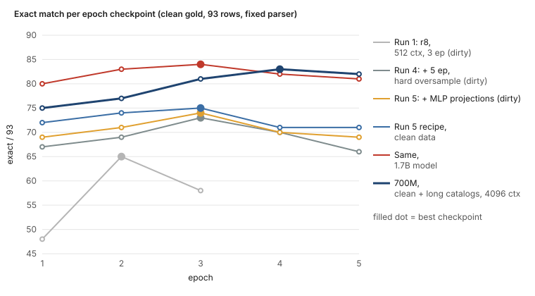

In the [manuscript extraction post](/blog/From-Manuscript-Transcriptions-to-JSON-A-Configurable-Extraction-Pipeline/) I argued that fine-tuning should not be step one. For one narrow sub-problem of the library migration it turned out to be exactly the right step, and a small adapter on a consumer GPU ended up doing most of the work.

The sub-problem: a catalog field holds a run of literature references glued together, and the database wants one row per reference. The model has to return **exact, in-order substrings** of the input, one per line. No paraphrasing, no normalizing, no "helpful" cleanup. Out of the box, both models I tried scored **0/93 exact**. They knew what a citation looks like, they just couldn't stop rewriting it.

---

## Setup

- **Models:** `LiquidAI/LFM2-700M` locally, a 1.7B Liquid model on the cluster's L40 nodes.
- **Hardware:** RTX 3060 Ti (8 GB) at home, L40 (48 GB) on the HPC side. Code and data sync over Tailscale with a small `rsync` script that skips adapters and caches (about 6 GB down to 5 MB).
- **Training:** PEFT `LoraConfig` + TRL `SFTTrainer`, bf16, gradient checkpointing, batch 1 with gradient accumulation 8, learning rate 2e-4. Each example is a chat pair: catalog text in, newline-joined spans out.
- **Data:** about 840 hand-checked clean rows, an OCR-noisy "dirty" twin of the same rows, and 131 reconstructed long catalogs with many spans each.
- **Eval:** a fixed 93-row clean held-out set. **Exact** means the whole predicted list matches. I also track bag-of-spans F1, break results down by how many spans a row has, and score every epoch checkpoint, not just the last one.

Experiments are TOML configs (datasets with their own train/eval fractions, an oversample block, LoRA knobs), so every row in the tables below maps to one file.

---

## The Ablation Ladder

The first series trained on the dirty data, changing one thing per run. Later runs switched to clean data, a bigger model, and finally a training mix with extra long catalogs. Every adapter below was scored at every epoch checkpoint against the same clean gold:

| Run | Change | Exact (final) | Exact (best, epoch) | 5-7 spans (final) |
| :--- | :--- | :--- | :--- | :--- |
| 0 | no adapter (700M) | 0/93 | n/a | 0/32 |
| 1 | baseline: r8, 512 tokens, 3 epochs, dirty data | 58/93 | 65 (2) | 14/32 |
| 2 | context 1536 | 61/93 | 62 (2) | 15/32 |
| 3 | rank 16 (α=32) | 66/93 | 66 (3) | 17/32 |
| 4 | 5 epochs, hard rows oversampled | 66/93 | 73 (3) | 19/32 |
| 5 | adapt MLP too (`up`/`down`/`gate`) | 69/93 | 74 (3) | 20/32 |
| 6 | run 5 recipe, clean data | 71/93 | 75 (3) | 20/32 |
| 7 | same, 1.7B model | 81/93 | **84** (3) | 29/32 |
| 8 | 700M, clean + reconstructed long catalogs, 4096 context | 82/93 | **83** (4) | 29/32 |

On the 700M model, the knobs (context, rank, epochs, oversampling, target modules) together moved the final score from 58 to 69. Switching from dirty to clean training data added only 2 more. Both changes are real, but neither is dramatic, and on 93 rows a single example is about 1.1 points.

The two jumps that clearly matter are model size (71 to 81) and data shape. Run 8 is the result I like most: the 700M model on the 8 GB card lands within one row of the 1.7B run once the training mix has enough long catalogs (hard rows oversampled 3x, 2406 training rows total). The 5 to 7 span bucket went from 20/32 to 29/32, and rows with 8 or more spans reached **3/6** at the best checkpoint. The dirty-trained runs never got past 1/6 there. Data shape moved the plateau that adapter knobs couldn't.

### The +15 That Wasn't

An earlier draft of this post had a different headline: training on clean data instead of dirty was worth **+15 exact** (56 to 71), more than all the adapter knobs combined. It was a nice story, and it was mostly a scoring bug.

The eval parser keeps only output lines that are substrings of the input, and it had a fallback that stripped list numbering like `1. ` or `2) ` when a line didn't match. Catalog rows contain units like `12. Jahrhundert`, so the fallback turned a perfect prediction into `Jahrhundert`, and the row failed. The clean-data adapters happened to be scored after I fixed it, the dirty-trained ones before. When I re-scored every checkpoint with one script, run 5 went from 56 to 69 with **identical raw model output**. All 13 rows that flipped came from the parser, not the model.

The same bug also produced a pattern I had over-interpreted. On the old dirty-gold numbers, run 5 raised exact while lowering F1, and I read that as the MLP adapters over-splitting. With the fixed parser, run 5 is better on both metrics (F1 0.908 against 0.876 for run 4). So the lesson I'm keeping is about measurement: if the scorer changes, re-score everything, including the runs you already wrote about.

### Picking the Checkpoint

The sweep also showed that the last checkpoint is usually not the best one:



Every 5-epoch run peaks at epoch 3 or 4 and then gives back 1 to 7 rows. Run 4 is the extreme case: 73 at epoch 3 and 66 at epoch 5, which is the gap between "oversampling is the best lever" and "oversampling does nothing." Most of the loss is in the 5 to 7 span bucket. My read is that the adapter starts memorizing the oversampled hard rows, which it sees several times per epoch. The long-catalog run (8) is the exception: it peaks at epoch 4 and barely drops, probably because 131 genuinely different long catalogs are harder to memorize than repeated copies of the same hard rows. I haven't checked training loss against this yet.

Evaluating all five checkpoints of a run takes about 12 minutes for the 700M model and about 27 for the 1.7B model on the 3060 Ti (roughly 140 s versus 320 s per pass over 93 rows). That is cheap next to training, and it changes the conclusions, so scoring every checkpoint is now part of the pipeline.

---

## What the Adapter Is Actually Doing

To make sure I understood what I was configuring, I wrote a toy `LoRALinear` next to the real pipeline, loosely following the torchtune LoRA tutorial. The forward pass is the whole idea:

```python
frozen_out = self.linear(x)
lora_out = self.lora_b(self.lora_a(self.dropout(x)))
return frozen_out + (self.alpha / self.rank) * lora_out
```

The base weight stays frozen, and only the low-rank pair `A` (in × r) and `B` (r × out) trains. PEFT initializes `B` to zero, so step 0 is exactly the base model. With r=16 and α=32 the update is scaled by 2, which is why going from r8 to r16 at fixed α isn't a pure "more capacity" change: it also changes the effective step size of the adapter. I didn't separate those two effects, honestly, and I should have.

For this task the adapter mostly learns two things the base model already half-knows: output format (one span per line, nothing else) and boundary decisions (where a title ends and the next author begins). That is a good fit for a low-rank update. The long-tail failures look different: on 8+ span rows the model drops a prefix or glues two titles, which reads more like a long-range copying problem than a knowledge gap.

Memory on 8 GB was manageable once gradient checkpointing was on. The 700M base in bf16 is about 1.4 GB of weights, the r16 adapter over all seven projections is tiny next to that, and activations at 4096 tokens are what actually decides whether a run fits.

---

## What This Connects To

The setup is one frozen base and many small task adapters. Each adapter is a few megabytes, trains overnight on a consumer card, and can be swapped per workload. That is a different cost model from full fine-tuning, and it raises the next systems question: what does it take to serve many of these at once, or to keep updating one as new catalog conventions show up?

It also changed how I think about small models. A 700M model that fits comfortably on an 8 GB card was competitive with a model more than twice its size once the data was right. That matters if this kind of extraction ever has to run close to the scanner instead of on a cluster.

Things I haven't measured yet and would check next:

- **One seed per config.** On 93 rows, one example is about 1.1 points. Runs 2 and 3, and the clean-versus-dirty gap, might be inside the noise.
- **Why 4096 context hurt the 1.7B run** (81 to 75 at the final checkpoint). It saves a checkpoint every 16 steps instead of once per epoch, which suggests longer packed sequences changed the number of optimizer updates. The checkpoint sweep for that run is still going (72/93 at step 64).
- **Training throughput.** I have quality numbers but no tokens/s or peak-memory table per config. Profiling the train step is the next artifact.
- **Constrained decoding** to force every output line to be a substring of the input. That would turn the exact-copy requirement into a guarantee instead of something the adapter has to learn.
- **The visual half.** A sibling project LoRA-tunes a small VLM to draw one box per literature entry on a page image, instead of the merged multi-line blocks YOLO layout detection gives me. It's scaffolded, no results yet.

---

## Takeaways

1. **Re-score everything when the scorer changes.** A parser fallback that ate `12. ` from `12. Jahrhundert` turned a +2 effect into a +15 headline.
2. **Score every checkpoint.** The best epoch beat the last one by up to 7 rows, enough to flip which lever looked useful.
3. **Bucket the eval by difficulty.** The aggregate score hid that 8+ span rows barely moved until the training data had long catalogs in it.
4. **Add distinct hard examples, not just repeats.** Oversampling the same hard rows peaked early and then decayed. 131 reconstructed long catalogs moved the 5 to 7 bucket from 20/32 to 29/32 and held.
5. **Try the small model with the right data before the big one.** 700M on 8 GB reached 83/93, against 84/93 for 1.7B.
6. **Keep every experiment as a config file.** Ablations stay comparable, and the same run moves from the home GPU to the cluster without edits.

---

### References

* Hu et al., *LoRA: Low-Rank Adaptation of Large Language Models* (2021). [arXiv:2106.09685](https://arxiv.org/abs/2106.09685)
* Hugging Face [PEFT](https://github.com/huggingface/peft) (`LoraConfig`) and [TRL](https://huggingface.co/docs/trl/sft_trainer) (`SFTTrainer`).
* [torchtune LoRA fine-tuning tutorial](https://docs.pytorch.org/torchtune/stable/tutorials/lora_finetune.html) (reference for the toy `LoRALinear`).
* Liquid AI, [LFM2 models](https://huggingface.co/LiquidAI) on Hugging Face.
* Chu et al., *SFT Memorizes, RL Generalizes* (2025). [arXiv:2501.17161](https://arxiv.org/abs/2501.17161)
