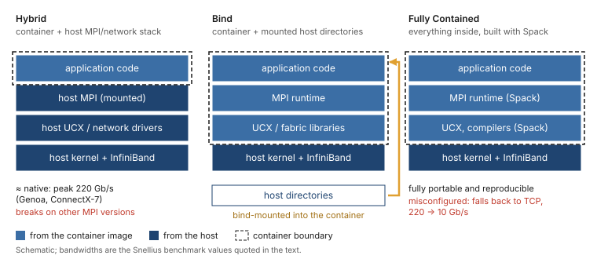
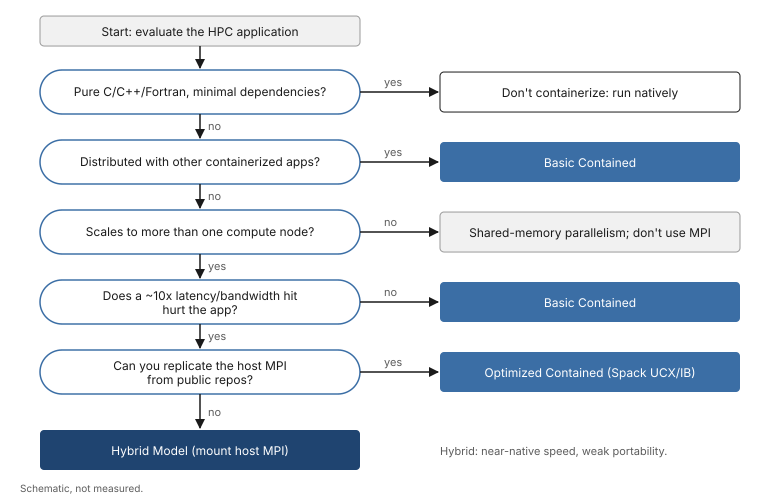

In enterprise software, containers are a solved problem. Docker is the default and the overhead is usually negligible.

HPC is different. Unprivileged namespaces, proprietary fabrics (InfiniBand, Cray Slingshot), and site-specific drivers mean the wrong container setup can cut network performance by **10x to 20x**.

Based on benchmarks on *Snellius*, this post compares container models and gives a flowchart for when (and how) to containerize.

---

## The Contenders: Container Models in HPC

With **Apptainer** (formerly Singularity), you usually pick one of these models:



### 1. The Hybrid Model
The container holds your application code. At runtime, you mount the host's MPI and network drivers.
*   **Pros:** Excellent performance. In our benchmarks, Hybrid matched bare metal (peak **220 Gb/s** on Genoa ConnectX-7).
*   **Cons:** Poor portability. The container depends on the host's software stack; on a cluster with a different MPI version you often get dynamic linking errors.

### 2. The Fully Contained Model
Everything is inside the container. Compilers, MPI, and UCX are built from source in the image (usually with **Spack**).
*   **Pros:** Full portability and reproducibility.
*   **Cons:** Large slowdowns if misconfigured. Without careful network setup, the container's MPI cannot use the host's InfiniBand drivers and falls back to TCP over Ethernet (**220 Gb/s down to 10 Gb/s**).

---

## Spack: Composing the Fully Contained Stack
We used Spack to build the Fully Contained image. Here is a `spack.yaml` for a containerized OpenMPI stack with CUDA, targeting an NVIDIA A100:

```
spack:
  specs:
  - gmake@4.3
  - openmpi@4.1.5 fabrics=ucx,ofi +pmi +legacylaunchers +orterunprefix +cuda cuda_arch=80
  - libfabric fabrics=sockets,tcp,udp,psm2,verbs,mlx
  - ucx
  - slurm
  - cuda@12.1.0
  - nccl +cuda cuda_arch=80
  - pmix
  concretizer:
    unify: true
  config:
    install_tree: /opt/software
  view: /opt/view
```

Even with a good Spack spec, you must mount the host's NVIDIA drivers (Apptainer's `--nv` flag). Otherwise the container's CUDA clashes with the host driver and fails at startup.

---

## The Decision Flowchart
I turned our results into a flowchart:



### How to read it

1.  **Minimal dependencies:** For a simple C/Fortran code with basic libraries, skip containers. Native runs have the least noise and no namespace complexity.
2.  **Single node:** If the workload stays on one node (OpenMP or shared memory, no MPI), **Basic Contained** is enough. There is no InfiniBand setup to worry about.
3.  **Latency-sensitive:** For communication-bound multi-node codes, choose **Optimized Contained** (Spack-built UCX/InfiniBand drivers that match the host kernel) or **Hybrid** (mount the host's MPI).

---

## Summary
*   **Hybrid wins on performance:** for communication-heavy workloads it is the best balance of easy setup and near-native speed.
*   **Fully Contained wins on portability:** but it takes ongoing work to keep UCX, Spack, and host driver versions aligned.

This flowchart should save you much of the trial and error I went through on Snellius.

---

### References

* De Sensi et al., *Noise in the Clouds: Influence of Network Performance Variability on Application Scalability* (2022). [arXiv:2210.15315](https://arxiv.org/abs/2210.15315)
* De Sensi et al., *Exploring GPU-to-GPU Communication: Insights into Supercomputer Interconnects* (IEEE SC24). [arXiv:2408.14090](https://arxiv.org/abs/2408.14090)
* Apptainer Contributors, [*Fakeroot Feature — Apptainer User Guide*](https://apptainer.org/docs/user/latest/fakeroot.html)
* Full list: [All references](/readinglist/).

---
